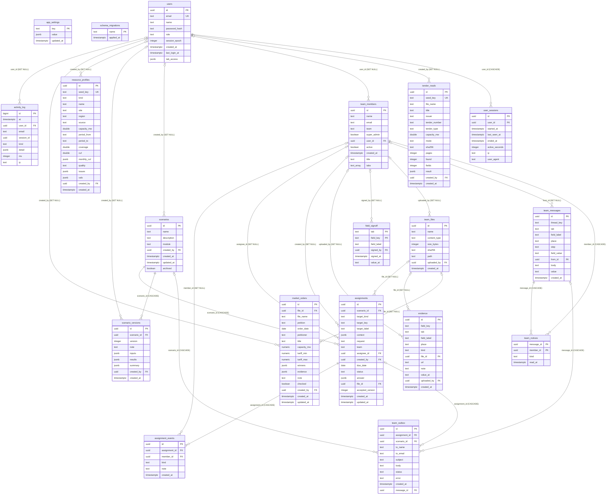

# TenderOS Demo 2: the database

Generated by `tools/gen_db_doc.py` from the live database's catalog and the code; do not edit by hand.
Re-run `DATABASE_URL=… python3 tools/gen_db_doc.py` after a migration or a change to the code that uses a table.

Postgres database with **19 tables** in schema `public` (18 application tables from the migrations plus `schema_migrations`): `activity_log`, `app_settings`, `assignment_events`, `assignments`, `evidence`, `field_signoff`, `market_orders`, `resource_profiles`, `scenario_versions`, `scenarios`, `schema_migrations`, `team_files`, `team_members`, `team_messages`, `team_notices`, `team_outbox`, `tender_reads`, `user_sessions`, `users`.
Schema from `web/db/migrations/` (12 files, `001_init.sql` … `012_evidence.sql`), applied in name order on web start by `web/lib/db.js` migrate (each file in its own transaction, recorded in `schema_migrations`, under advisory lock 727401).

## What the database holds, and what lives elsewhere

TenderOS keeps in Postgres only what has to be shared between people or kept after the browser
closes. Everything is written by the Next.js web app (`web/lib/*.js`, server-only modules, through
`web/lib/db.js`); the Python engine (`engine/`) never touches the database.

| In Postgres | Tables |
| --- | --- |
| Sign-in and access | `users`, `user_sessions`, `app_settings` (default tabs), `schema_migrations` |
| The scenario library (saved cases with their versions) | `scenarios`, `scenario_versions` |
| Usage | `activity_log` |
| Reference data shared by the team | `resource_profiles` (wind and solar profiles), `tender_reads` (tender readings), `market_orders` (CERC orders) |
| Team work on a saved bid | `team_members`, `team_files`, `assignments`, `assignment_events`, `team_outbox` |
| Team mode and evidence on any input box | `team_messages`, `team_notices`, `evidence`, `field_signoff` |

What is **not** in the database:

* **The working state of every tab is in the browser.** Each tab keeps its React state and writes
  it to `localStorage` a few hundred milliseconds after each change; only "Save" puts a copy in
  `scenarios` / `scenario_versions` (and only the Round the clock, BESS and SECI tabs have Save).
  Keys: Tender to Bid `fdre.bid.v4` (`web/src/bid/BidTab.jsx`), SECI RTC tender `tenderos.seci.v1`
  (`web/src/seci/SeciTab.jsx`), Round the clock `fdre.rtc.v1` (`web/src/rtc/RtcTab.jsx`), BESS
  tender `fdre.bess.v1` (`web/src/bess/BessTab.jsx`), CfD bid `fdre.cfd.v1` (`web/src/cfd/model.js`),
  What-if `tenderos-whatif` (`web/src/whatif/WhatIfTab.jsx`, not when embedded in the SECI tab),
  the theme `tenderos-theme` and the ping-icon mode `tenderos.pingIcons`. The last sizing's hourly
  dispatch and the optimizer's cloud are module-level variables that survive switching tabs but
  not a reload.
* **Uploaded files are on disk**, under `FILES_DIR` (`/data/files` in `docker-compose.yml`, the
  `team_files` volume; `web/data/files` when unset), written and read only by `web/lib/files.js`
  (`saveUpload`, `readStored`). The database row (`team_files`) carries the metadata and the
  relative path `<uuid>.<ext>`.
* **Engine jobs are JSON files, not rows.** A tender read is a job file in `EXTRACTION_JOBS_DIR`
  (default `/tmp/tenderos_extraction_jobs`, `engine/extraction/jobs.py`) and a 15-minute dispatch
  a job file plus its ZIP and XLSX in `DISPATCH15_JOBS_DIR` (default `<tmp>/tenderos_dispatch15`,
  `engine/sizing/dispatch15.py`); files older than 24 hours are deleted when a job starts. The
  browser polls the job and then saves the finished reading to `tender_reads` itself.
* **The MCP server's bids are in memory**: `web/lib/mcp.js` keeps one bid state per MCP session
  in a `Map` of the web process (6-hour TTL, at most 50); a restart starts a fresh bid.
* **Reference data in code and static files**: the SECI tender pack (`web/src/seci/seci-rtc-tm-v.json`
  and `web/src/seci/terms.js`), the SECI auction results (`web/src/market/seed.js`), the IEX hourly
  prices (`web/public/market/iex_hourly_prices.json`), and the seed files that are loaded into
  `resource_profiles` and `tender_reads` on start (`web/db/seed/`).
* **Sessions are a signed cookie** (`tenderos_session`, HS256 JWT, `web/lib/session.js`); the
  database only records them in `user_sessions` for the usage report.

## Entity relationship diagram

## Tables

### `activity_log`

The usage log: one row per event with its kind, a jsonb `detail` (trimmed to 2,000 characters) and the compute time where it applies. Server-side kinds: `login`, `login_failed`, `logout`, `engine` (every non-GET call proxied to the engine, `web/app/api/[...path]/route.js`), `scenario_save`, `tender_read`, `export`, `profile_upload`, `voice`; browser-reported kinds (`web/src/activity.js` trackEvent, allowed by CLIENT_KINDS): `tab`, `optimize`, `run`, `export`, `download`. Purged after 400 days.

Created by `004_activity.sql`.

| Column | Type | Null | Default |
| --- | --- | --- | --- |
| `id` | bigint | no | nextval('activity_log_id_seq'::regclass) |
| `at` | timestamp with time zone | no | now() |
| `user_id` | uuid | yes |  |
| `email` | text | no | ''::text |
| `session_id` | uuid | yes |  |
| `kind` | text | no |  |
| `detail` | jsonb | no | '{}'::jsonb |
| `ms` | integer | yes |  |
| `ip` | text | no | ''::text |

* Primary key: `id`.
* Foreign key `user_id` → `users` (`id`), on delete SET NULL.
* Index `activity_log_at`: `(at DESC)`.
* Index `activity_log_user_at`: `(user_id, at DESC)`.

**Written by** (direct SQL): `web/lib/activity.js` logEvent (INSERT); `web/lib/activity.js` purgeOldActivity (DELETE).

**Read by** (direct SQL, besides the writers): `web/lib/activity.js` recentEvents; `web/lib/activity.js` usageSummary.

**Reached through**: `GET, POST, PUT, PATCH, DELETE /api/[...path]` (logEvent); `POST, GET /api/activity` (logEvent, recentEvents, usageSummary); `GET /api/auth/demo` (logEvent); `POST /api/auth/login` (logEvent); `POST /api/auth/logout` (logEvent); `POST /api/bid/model` (logEvent); `POST /api/bid/queries` (logEvent); `POST /api/cfd/model` (logEvent); `POST /api/plant/justification` (logEvent); `GET, POST /api/profiles` (logEvent); `POST /api/rtc/model` (logEvent); `POST /api/scenarios/[id]/restore` (logEvent); `GET, PUT, PATCH, DELETE /api/scenarios/[id]` (logEvent); `GET /api/scenarios/export` (logEvent); `GET, POST /api/scenarios` (logEvent); `POST /api/seci/forms` (logEvent); `POST /api/seci/letters` (logEvent); `GET, POST /api/seci/live` (logEvent); `GET, POST /api/tenders` (logEvent).

### `app_settings`

Deployment-wide settings as key → jsonb. The only key the code writes is `default_tabs` (`web/app/api/settings/tabs/route.js`, read by `web/lib/auth.js` currentUserWithAccess).

Created by `002_tab_access.sql`.

| Column | Type | Null | Default |
| --- | --- | --- | --- |
| `key` | text | no |  |
| `value` | jsonb | no |  |
| `updated_at` | timestamp with time zone | no | now() |

* Primary key: `key`.

**Written by** (direct SQL): `web/lib/settings.js` setSetting (INSERT).

**Read by** (direct SQL, besides the writers): `web/lib/settings.js` getSetting.

**Reached through**: `GET, PUT /api/settings/tabs` (getSetting, setSetting).

### `assignment_events`

The history of each assignment: created, submitted, accepted, returned, cancelled, reassigned, comment, emailed, email_failed, with who and a note (`web/lib/team.js` event / notify).

Created by `008_team.sql`.

| Column | Type | Null | Default |
| --- | --- | --- | --- |
| `id` | uuid | no | gen_random_uuid() |
| `assignment_id` | uuid | no |  |
| `member_id` | uuid | yes |  |
| `kind` | text | no |  |
| `note` | text | no | ''::text |
| `created_at` | timestamp with time zone | no | now() |

* Primary key: `id`.
* Foreign key `assignment_id` → `assignments` (`id`), on delete CASCADE.
* Foreign key `member_id` → `team_members` (`id`), on delete SET NULL.
* Check `assignment_events_kind_check`: `((kind = ANY (ARRAY['created'::text, 'submitted'::text, 'accepted'::text, 'returned'::text, 'cancelled'::text, 'reassigned'::text, 'comment'::text, 'emailed'::text, 'email_failed'::text])))`.
* Index `assignment_events_idx`: `(assignment_id, created_at)`.

**Written by** (direct SQL): `web/lib/team.js` event (INSERT); `web/lib/team.js` notify (INSERT).

**Read by** (direct SQL, besides the writers): `web/lib/team.js` listAssignments.

**Reached through**: `POST /api/team/assignments/[id]` (actOnAssignment); `GET, POST /api/team/assignments` (createAssignment, listAssignments).

### `assignments`

Work assigned on a data point of a saved bid: which scenario, what kind of data point (`field`, `cost`, `finance`, `document`, `condition`), its key in the bid state (`web/src/team/apply.js` documents the key forms), the request, the team or person asked, due date, status, the answer (jsonb), the file submitted and the scenario version the acceptance was saved as.

Created by `008_team.sql`.

| Column | Type | Null | Default |
| --- | --- | --- | --- |
| `id` | uuid | no | gen_random_uuid() |
| `scenario_id` | uuid | no |  |
| `target_kind` | text | no |  |
| `target_key` | text | no |  |
| `target_label` | text | no |  |
| `context` | jsonb | no | '{}'::jsonb |
| `request` | text | no | ''::text |
| `team` | text | no |  |
| `assignee_id` | uuid | yes |  |
| `created_by` | uuid | yes |  |
| `due_date` | date | yes |  |
| `status` | text | no | 'open'::text |
| `answer` | jsonb | yes |  |
| `file_id` | uuid | yes |  |
| `accepted_version` | integer | yes |  |
| `created_at` | timestamp with time zone | no | now() |
| `updated_at` | timestamp with time zone | no | now() |

* Primary key: `id`.
* Foreign key `assignee_id` → `team_members` (`id`), on delete SET NULL.
* Foreign key `created_by` → `team_members` (`id`), on delete SET NULL.
* Foreign key `file_id` → `team_files` (`id`), on delete SET NULL.
* Foreign key `scenario_id` → `scenarios` (`id`), on delete CASCADE.
* Check `assignments_status_check`: `((status = ANY (ARRAY['open'::text, 'submitted'::text, 'accepted'::text, 'returned'::text, 'cancelled'::text])))`.
* Check `assignments_target_kind_check`: `((target_kind = ANY (ARRAY['field'::text, 'cost'::text, 'finance'::text, 'document'::text, 'condition'::text])))`.
* Check `assignments_team_check`: `((team = ANY (ARRAY['management'::text, 'finance'::text, 'procurement'::text, 'legal'::text, 'technical'::text])))`.
* Index `assignments_assignee_idx`: `(assignee_id, status)`.
* Index `assignments_scenario_idx`: `(scenario_id, status, updated_at DESC)`.

**Written by** (direct SQL): `web/lib/team.js` actOnAssignment (UPDATE); `web/lib/team.js` createAssignment (INSERT).

**Read by** (direct SQL, besides the writers): `web/lib/team.js` listOutbox.

**Reached through**: `POST /api/team/assignments/[id]` (actOnAssignment); `GET, POST /api/team/assignments` (createAssignment); `GET /api/team/outbox` (listOutbox).

### `evidence`

Evidence attached to an input box: a file, a link or a note, with the box's key, label and place, who attached it and the box's value at the time (`web/lib/evidence.js`).

Created by `012_evidence.sql`.

| Column | Type | Null | Default |
| --- | --- | --- | --- |
| `id` | uuid | no | gen_random_uuid() |
| `field_key` | text | no |  |
| `tab` | text | no |  |
| `field_label` | text | no |  |
| `place` | text | no | ''::text |
| `kind` | text | no |  |
| `file_id` | uuid | yes |  |
| `url` | text | yes |  |
| `note` | text | yes |  |
| `value_at` | text | no | ''::text |
| `uploaded_by` | uuid | yes |  |
| `created_at` | timestamp with time zone | no | now() |

* Primary key: `id`.
* Foreign key `file_id` → `team_files` (`id`), on delete SET NULL.
* Foreign key `uploaded_by` → `team_members` (`id`), on delete SET NULL.
* Check `evidence_kind_check`: `((kind = ANY (ARRAY['file'::text, 'link'::text, 'note'::text])))`.
* Index `evidence_tab_field_idx`: `(tab, field_key)`.

**Written by** (direct SQL): `web/lib/evidence.js` addEvidence (INSERT); `web/lib/evidence.js` deleteEvidence (DELETE).

**Read by** (direct SQL, besides the writers): `web/lib/evidence.js` getEvidence; `web/lib/evidence.js` listEvidence; `web/lib/evidence.js` registerCsvFor; `web/lib/evidence.js` signOff.

**Reached through**: `DELETE /api/evidence/[id]` (deleteEvidence); `GET /api/evidence/register` (registerCsvFor); `GET, POST /api/evidence` (addEvidence, listEvidence); `POST /api/evidence/signoff` (signOff).

### `field_signoff`

A super admin's sign-off of a box's value, one row per box; `value_at` keeps the value signed, so a later change shows as "signed off at an older value".

Created by `012_evidence.sql`.

| Column | Type | Null | Default |
| --- | --- | --- | --- |
| `tab` | text | no |  |
| `field_key` | text | no |  |
| `field_label` | text | no | ''::text |
| `signed_by` | uuid | yes |  |
| `signed_at` | timestamp with time zone | no | now() |
| `value_at` | text | no | ''::text |

* Primary key: `tab`, `field_key`.
* Foreign key `signed_by` → `team_members` (`id`), on delete SET NULL.

**Written by** (direct SQL): `web/lib/evidence.js` signOff (DELETE/INSERT).

**Read by** (direct SQL, besides the writers): `web/lib/evidence.js` deleteEvidence; `web/lib/evidence.js` getEvidence; `web/lib/evidence.js` listEvidence; `web/lib/evidence.js` registerCsvFor.

**Reached through**: `DELETE /api/evidence/[id]` (deleteEvidence); `GET /api/evidence/register` (registerCsvFor); `GET, POST /api/evidence` (addEvidence, listEvidence); `POST /api/evidence/signoff` (signOff).

### `market_orders`

Recent tenders: CERC tariff-adoption orders uploaded as PDF, read by the engine (`POST /api/bid/cerc-order`) into petition, date, petitioner, capacity, the tariff range and the winners, with the page and quote of each fact, then corrected by hand (`checked`). The SECI auction results beside them are code (`web/src/market/seed.js`), not rows.

Created by `010_market.sql`.

| Column | Type | Null | Default |
| --- | --- | --- | --- |
| `id` | uuid | no | gen_random_uuid() |
| `file_id` | uuid | yes |  |
| `file_name` | text | no | ''::text |
| `petition` | text | no | ''::text |
| `order_date` | date | yes |  |
| `petitioner` | text | no | ''::text |
| `title` | text | no | ''::text |
| `capacity_mw` | numeric | yes |  |
| `tariff_min` | numeric | yes |  |
| `tariff_max` | numeric | yes |  |
| `winners` | jsonb | no | '[]'::jsonb |
| `evidence` | jsonb | no | '{}'::jsonb |
| `note` | text | no | ''::text |
| `checked` | boolean | no | false |
| `created_by` | uuid | yes |  |
| `created_at` | timestamp with time zone | no | now() |
| `updated_at` | timestamp with time zone | no | now() |

* Primary key: `id`.
* Foreign key `created_by` → `users` (`id`), on delete SET NULL.
* Foreign key `file_id` → `team_files` (`id`), on delete SET NULL.
* Index `market_orders_date`: `(order_date DESC NULLS LAST, created_at DESC)`.

**Written by** (direct SQL): `web/lib/market.js` addOrder (INSERT); `web/lib/market.js` deleteOrder (DELETE); `web/lib/market.js` updateOrder (UPDATE).

**Read by** (direct SQL, besides the writers): `web/lib/market.js` listOrders; `web/lib/market.js` orderFile.

**Reached through**: `PATCH, DELETE /api/market/[id]` (deleteOrder, updateOrder); `GET /api/market/files/[id]` (orderFile); `GET, POST /api/market` (addOrder, listOrders).

### `resource_profiles`

The library of hourly wind and solar capacity-factor profiles (8,760 values in `vals`), built-in ones (`seed_key`, loaded from `web/db/seed/profiles/*.json` on start by `web/lib/profiles.js` seedProfiles) and uploads (`POST /api/profiles`), each with its CUF, monthly CUFs, quality and the issues found.

Created by `003_resource_profiles.sql`.

| Column | Type | Null | Default |
| --- | --- | --- | --- |
| `id` | uuid | no | gen_random_uuid() |
| `seed_key` | text | yes |  |
| `kind` | text | no |  |
| `name` | text | no |  |
| `site` | text | no | ''::text |
| `region` | text | no | ''::text |
| `source` | text | no | ''::text |
| `capacity_mw` | double precision | yes |  |
| `period_from` | text | yes |  |
| `period_to` | text | yes |  |
| `coverage` | double precision | yes |  |
| `cuf` | double precision | yes |  |
| `monthly_cuf` | jsonb | yes |  |
| `quality` | text | no | 'validated'::text |
| `issues` | jsonb | no | '[]'::jsonb |
| `vals` | jsonb | yes |  |
| `created_by` | uuid | yes |  |
| `created_at` | timestamp with time zone | no | now() |

* Primary key: `id`.
* Foreign key `created_by` → `users` (`id`), on delete SET NULL.
* Unique: `seed_key`.
* Check `resource_profiles_kind_check`: `((kind = ANY (ARRAY['wind'::text, 'solar'::text])))`.
* Check `resource_profiles_quality_check`: `((quality = ANY (ARRAY['validated'::text, 'suspect'::text, 'rejected'::text])))`.
* Index `resource_profiles_kind_idx`: `(kind, quality, name)`.

**Written by** (direct SQL): `web/lib/profiles.js` createProfile (INSERT); `web/lib/profiles.js` deleteProfile (DELETE); `web/lib/profiles.js` seedProfiles (DELETE/INSERT).

**Read by** (direct SQL, besides the writers): `web/lib/profiles.js` getProfile; `web/lib/profiles.js` listProfiles.

**Reached through**: `GET, DELETE /api/profiles/[id]` (deleteProfile, getProfile); `GET, POST /api/profiles` (createProfile, listProfiles).

### `scenario_versions`

One row per save of a scenario: the version number, a note, the full tab state (`inputs`), the results kept with it (`results`) and the headline numbers for lists and comparison (`summary`, the keys of `web/lib/summaryFields.js`). Versions are never updated: a restore adds a new version (`web/lib/scenarios.js` restoreVersion). See the JSON documents section for the shape per module.

Created by `001_init.sql`.

| Column | Type | Null | Default |
| --- | --- | --- | --- |
| `id` | uuid | no | gen_random_uuid() |
| `scenario_id` | uuid | no |  |
| `version` | integer | no |  |
| `note` | text | no | ''::text |
| `inputs` | jsonb | no |  |
| `results` | jsonb | yes |  |
| `summary` | jsonb | no | '{}'::jsonb |
| `created_by` | uuid | yes |  |
| `created_at` | timestamp with time zone | no | now() |

* Primary key: `id`.
* Foreign key `created_by` → `users` (`id`), on delete SET NULL.
* Foreign key `scenario_id` → `scenarios` (`id`), on delete CASCADE.
* Unique: `scenario_id`, `version`.
* Index `scenario_versions_latest_idx`: `(scenario_id, version DESC)`.

**Written by** (direct SQL): `web/lib/scenarios.js` addVersion (INSERT); `web/lib/scenarios.js` createScenario (INSERT).

**Read by** (direct SQL, besides the writers): `web/lib/scenarios.js` getScenario; `web/lib/scenarios.js` listScenarios.

**Reached through**: `POST /api/scenarios/[id]/restore` (restoreVersion); `GET, PUT, PATCH, DELETE /api/scenarios/[id]` (addVersion, getScenario); `GET /api/scenarios/export` (getScenario); `GET, POST /api/scenarios` (createScenario, listScenarios).

### `scenarios`

A saved case in the scenario library: its name, description, module (`rtc` Round the clock, `bess` BESS tender, `seci` SECI RTC tender; `fdre` is still allowed by the CHECK but `web/lib/scenarios.js` MODULES no longer accepts it), who created it, and whether it is archived. The content lives in `scenario_versions`.

Created by `001_init.sql`; changed by `005_bess_module.sql`, `007_seci_module.sql`.

| Column | Type | Null | Default |
| --- | --- | --- | --- |
| `id` | uuid | no | gen_random_uuid() |
| `name` | text | no |  |
| `description` | text | no | ''::text |
| `module` | text | no |  |
| `created_by` | uuid | yes |  |
| `created_at` | timestamp with time zone | no | now() |
| `updated_at` | timestamp with time zone | no | now() |
| `archived` | boolean | no | false |

* Primary key: `id`.
* Foreign key `created_by` → `users` (`id`), on delete SET NULL.
* Check `scenarios_module_check`: `((module = ANY (ARRAY['rtc'::text, 'fdre'::text, 'bess'::text, 'seci'::text])))`.
* Index `scenarios_updated_idx`: `(archived, updated_at DESC)`.

**Written by** (direct SQL): `web/lib/scenarios.js` addVersion (UPDATE); `web/lib/scenarios.js` createScenario (INSERT); `web/lib/scenarios.js` deleteScenario (DELETE); `web/lib/scenarios.js` updateScenarioMeta (UPDATE).

**Read by** (direct SQL, besides the writers): `web/lib/scenarios.js` getScenario; `web/lib/scenarios.js` listScenarios; `web/lib/team.js` createAssignment; `web/lib/team.js` getAssignment; `web/lib/team.js` listAssignments.

**Reached through**: `POST /api/scenarios/[id]/restore` (restoreVersion); `GET, PUT, PATCH, DELETE /api/scenarios/[id]` (addVersion, deleteScenario, getScenario, updateScenarioMeta); `GET /api/scenarios/export` (getScenario); `GET, POST /api/scenarios` (createScenario, listScenarios); `POST /api/team/assignments/[id]` (actOnAssignment); `GET, POST /api/team/assignments` (createAssignment, listAssignments).

### `schema_migrations`

Which `web/db/migrations/*.sql` files have been applied (`web/lib/db.js` migrate, run on start by `web/instrumentation.js`). Not created by a migration file.

Created by `web/lib/db.js` migrate (`CREATE TABLE IF NOT EXISTS`), not by a migration file.

| Column | Type | Null | Default |
| --- | --- | --- | --- |
| `name` | text | no |  |
| `applied_at` | timestamp with time zone | no | now() |

* Primary key: `name`.

**Written by** (direct SQL): `web/lib/db.js` migrate (CREATE/INSERT).

**Read by** (direct SQL, besides the writers): nothing else.

**Reached through**: no API route.

### `team_files`

Files people upload: on assignments (signed copies), as evidence on a box, and the CERC order PDFs of Recent tenders. The bytes are on disk under `FILES_DIR` named `<id>.<ext>` (`web/lib/files.js` saveUpload); the row holds the name, type, size, SHA-256 and that relative path.

Created by `008_team.sql`.

| Column | Type | Null | Default |
| --- | --- | --- | --- |
| `id` | uuid | no | gen_random_uuid() |
| `name` | text | no |  |
| `content_type` | text | no |  |
| `size_bytes` | integer | no |  |
| `sha256` | text | no |  |
| `path` | text | no |  |
| `uploaded_by` | uuid | yes |  |
| `created_at` | timestamp with time zone | no | now() |

* Primary key: `id`.
* Foreign key `uploaded_by` → `team_members` (`id`), on delete SET NULL.

**Written by** (direct SQL): `web/lib/files.js` saveUpload (INSERT).

**Read by** (direct SQL, besides the writers): `web/lib/evidence.js` deleteEvidence; `web/lib/evidence.js` getEvidence; `web/lib/evidence.js` listEvidence; `web/lib/evidence.js` registerCsvFor; `web/lib/evidence.js` signOff; `web/lib/market.js` orderFile; `web/lib/team.js` fileRow; `web/lib/team.js` getAssignment; `web/lib/team.js` listAssignments.

**Reached through**: `DELETE /api/evidence/[id]` (deleteEvidence); `GET /api/evidence/register` (registerCsvFor); `GET, POST /api/evidence` (addEvidence, listEvidence); `POST /api/evidence/signoff` (signOff); `GET /api/market/files/[id]` (orderFile); `GET, POST /api/market` (addOrder); `POST /api/team/assignments/[id]` (actOnAssignment, saveUpload); `GET, POST /api/team/assignments` (createAssignment, listAssignments); `GET /api/team/files/[id]` (fileRow).

### `team_members`

The tender's team: name, email, team (management, finance, procurement, legal, technical), super admin flag, the linked sign-in account (`user_id`) when there is one, job title and the tabs the person covers. In demo mode five seats are created on first use (`web/lib/team.js` seedDemo) and the visitor picks one ("View as", cookie `tenderos_member`).

Created by `008_team.sql`; changed by `011_team_messages.sql`.

| Column | Type | Null | Default |
| --- | --- | --- | --- |
| `id` | uuid | no | gen_random_uuid() |
| `name` | text | no |  |
| `email` | text | no | ''::text |
| `team` | text | no |  |
| `super_admin` | boolean | no | false |
| `user_id` | uuid | yes |  |
| `active` | boolean | no | true |
| `created_at` | timestamp with time zone | no | now() |
| `title` | text | no | ''::text |
| `tabs` | text[] | no | '{}'::text[] |

* Primary key: `id`.
* Foreign key `user_id` → `users` (`id`), on delete SET NULL.
* Check `team_members_team_check`: `((team = ANY (ARRAY['management'::text, 'finance'::text, 'procurement'::text, 'legal'::text, 'technical'::text])))`.

**Written by** (direct SQL): `web/lib/team.js` actingMember (INSERT/UPDATE); `web/lib/team.js` addMember (INSERT); `web/lib/team.js` seedDemo (INSERT/UPDATE); `web/lib/team.js` updateMember (UPDATE).

**Read by** (direct SQL, besides the writers): `web/lib/evidence.js` deleteEvidence; `web/lib/evidence.js` getEvidence; `web/lib/evidence.js` listEvidence; `web/lib/evidence.js` registerCsvFor; `web/lib/evidence.js` signOff; `web/lib/team.js` actOnAssignment; `web/lib/team.js` createAssignment; `web/lib/team.js` getAssignment; `web/lib/team.js` listAssignments; `web/lib/team.js` listMembers; `web/lib/team.js` recipients; `web/lib/team.js` superAdmins; `web/lib/teamMessages.js` inbox; `web/lib/teamMessages.js` listThread.

**Reached through**: `DELETE /api/evidence/[id]` (deleteEvidence, requireMember); `GET /api/evidence/register` (registerCsvFor, requireMember); `GET, POST /api/evidence` (addEvidence, listEvidence, requireMember); `POST /api/evidence/signoff` (requireMember, signOff); `POST /api/team/act-as` (listMembers); `POST /api/team/assignments/[id]` (actOnAssignment, requireMember); `GET, POST /api/team/assignments` (createAssignment, listAssignments, requireMember); `GET /api/team/files/[id]` (requireMember); `PATCH /api/team/members/[id]` (requireMember, updateMember); `POST /api/team/members` (addMember, requireMember); `POST /api/team/messages/read` (requireMember); `GET, POST /api/team/messages` (inbox, listThread, postMessage, requireMember); `GET /api/team/outbox` (requireMember); `GET /api/team` (teamState).

### `team_messages`

Team mode: a message in the thread of one input box of one tab (`thread_key` = the box's key, `web/src/team/mentions.js` threadKey), with where the box is, its value at the time, the text and an optional value offered for "Fill in".

Created by `011_team_messages.sql`.

| Column | Type | Null | Default |
| --- | --- | --- | --- |
| `id` | uuid | no | gen_random_uuid() |
| `thread_key` | text | no |  |
| `tab` | text | no |  |
| `field_label` | text | no |  |
| `place` | text | no | ''::text |
| `step` | text | no | ''::text |
| `field_value` | text | no | ''::text |
| `from_id` | uuid | yes |  |
| `body` | text | no |  |
| `value` | text | yes |  |
| `created_at` | timestamp with time zone | no | now() |

* Primary key: `id`.
* Foreign key `from_id` → `team_members` (`id`), on delete SET NULL.
* Index `team_messages_tab_idx`: `(tab, created_at DESC)`.
* Index `team_messages_thread_idx`: `(thread_key, created_at)`.

**Written by** (direct SQL): `web/lib/teamMessages.js` postMessage (INSERT).

**Read by** (direct SQL, besides the writers): `web/lib/teamMessages.js` inbox; `web/lib/teamMessages.js` listThread; `web/lib/teamMessages.js` markRead; `web/lib/teamMessages.js` threadCounts.

**Reached through**: `POST /api/team/messages/read` (markRead); `GET, POST /api/team/messages` (inbox, listThread, postMessage, threadCounts).

### `team_notices`

Each member's inbox: the messages they were mentioned in (`mention`) or that answered a thread they are in (`reply`), and when they read them.

Created by `011_team_messages.sql`.

| Column | Type | Null | Default |
| --- | --- | --- | --- |
| `message_id` | uuid | no |  |
| `member_id` | uuid | no |  |
| `kind` | text | no |  |
| `read_at` | timestamp with time zone | yes |  |

* Primary key: `message_id`, `member_id`.
* Foreign key `member_id` → `team_members` (`id`), on delete CASCADE.
* Foreign key `message_id` → `team_messages` (`id`), on delete CASCADE.
* Check `team_notices_kind_check`: `((kind = ANY (ARRAY['mention'::text, 'reply'::text])))`.
* Index `team_notices_member_idx`: `(member_id, read_at)`.

**Written by** (direct SQL): `web/lib/teamMessages.js` markRead (UPDATE); `web/lib/teamMessages.js` postMessage (INSERT).

**Read by** (direct SQL, besides the writers): `web/lib/teamMessages.js` inbox; `web/lib/teamMessages.js` threadCounts.

**Reached through**: `POST /api/team/messages/read` (markRead); `GET, POST /api/team/messages` (inbox, postMessage, threadCounts).

### `team_outbox`

Every email team sharing composes (`web/lib/team.js` notify and `web/lib/teamMessages.js` emailMentioned): sent through SMTP, failed, or kept as the demo outbox when there is no SMTP on a demo deployment.

Created by `009_team_outbox.sql`; changed by `011_team_messages.sql`.

| Column | Type | Null | Default |
| --- | --- | --- | --- |
| `id` | uuid | no | gen_random_uuid() |
| `assignment_id` | uuid | yes |  |
| `scenario_id` | uuid | yes |  |
| `to_name` | text | no | ''::text |
| `to_email` | text | no |  |
| `subject` | text | no |  |
| `body` | text | no |  |
| `status` | text | no |  |
| `error` | text | yes |  |
| `created_at` | timestamp with time zone | no | now() |
| `message_id` | uuid | yes |  |

* Primary key: `id`.
* Foreign key `assignment_id` → `assignments` (`id`), on delete CASCADE.
* Foreign key `message_id` → `team_messages` (`id`), on delete CASCADE.
* Foreign key `scenario_id` → `scenarios` (`id`), on delete CASCADE.
* Check `team_outbox_status_check`: `((status = ANY (ARRAY['sent'::text, 'failed'::text, 'demo'::text])))`.
* Index `team_outbox_scenario_idx`: `(scenario_id, created_at DESC)`.

**Written by** (direct SQL): `web/lib/team.js` notify (INSERT); `web/lib/teamMessages.js` emailMentioned (INSERT).

**Read by** (direct SQL, besides the writers): `web/lib/team.js` listOutbox.

**Reached through**: `POST /api/team/assignments/[id]` (actOnAssignment); `GET, POST /api/team/assignments` (createAssignment); `GET, POST /api/team/messages` (postMessage); `GET /api/team/outbox` (listOutbox).

### `tender_reads`

Tenders read by the engine (Tender to Bid): the whole reading with its page evidence in `result`, plus the columns the list shows (title, issuer, number, type, capacity, mode `rules` or `llm`, page and field counts). Saved best-effort after every read (`web/src/bid/readTender.js` → `POST /api/tenders`); the same file read the same way again replaces the earlier row (same `sha256` and `mode`). Built-in readings come from `web/db/seed/tenders/*.json` (`seed_key`).

Created by `006_tender_reads.sql`.

| Column | Type | Null | Default |
| --- | --- | --- | --- |
| `id` | uuid | no | gen_random_uuid() |
| `seed_key` | text | yes |  |
| `file_name` | text | no |  |
| `title` | text | no | ''::text |
| `issuer` | text | no | ''::text |
| `tender_number` | text | no | ''::text |
| `tender_type` | text | no | ''::text |
| `capacity_mw` | double precision | yes |  |
| `mode` | text | no | 'rules'::text |
| `sha256` | text | yes |  |
| `pages` | integer | yes |  |
| `found` | integer | yes |  |
| `fields` | integer | yes |  |
| `result` | jsonb | no |  |
| `created_by` | uuid | yes |  |
| `created_at` | timestamp with time zone | no | now() |

* Primary key: `id`.
* Foreign key `created_by` → `users` (`id`), on delete SET NULL.
* Unique: `seed_key`.
* Index `tender_reads_created_idx`: `(created_at DESC)`.

**Written by** (direct SQL): `web/lib/tenders.js` saveTenderRead (DELETE/INSERT); `web/lib/tenders.js` seedTenderReads (INSERT).

**Read by** (direct SQL, besides the writers): `web/lib/tenders.js` getTenderRead; `web/lib/tenders.js` listTenderReads.

**Reached through**: `GET /api/tenders/[id]` (getTenderRead); `GET, POST /api/tenders` (listTenderReads, saveTenderRead).

### `user_sessions`

One row per sign-in: when it started, was last seen and ended, the active seconds added by the browser's heartbeat (`POST /api/activity` ping, at most 120 s per ping), the IP and user agent. Purged after 400 days (`web/lib/activity.js` purgeOldActivity, run on start).

Created by `004_activity.sql`.

| Column | Type | Null | Default |
| --- | --- | --- | --- |
| `id` | uuid | no | gen_random_uuid() |
| `user_id` | uuid | no |  |
| `started_at` | timestamp with time zone | no | now() |
| `last_seen_at` | timestamp with time zone | no | now() |
| `ended_at` | timestamp with time zone | yes |  |
| `active_seconds` | integer | no | 0 |
| `ip` | text | no | ''::text |
| `user_agent` | text | no | ''::text |

* Primary key: `id`.
* Foreign key `user_id` → `users` (`id`), on delete CASCADE.
* Index `user_sessions_started`: `(started_at DESC)`.
* Index `user_sessions_user_started`: `(user_id, started_at DESC)`.

**Written by** (direct SQL): `web/lib/activity.js` endSession (UPDATE); `web/lib/activity.js` purgeOldActivity (DELETE); `web/lib/activity.js` startSession (INSERT); `web/lib/activity.js` touchSession (UPDATE).

**Read by** (direct SQL, besides the writers): `web/lib/activity.js` recentSessions; `web/lib/activity.js` usageSummary.

**Reached through**: `POST, GET /api/activity` (recentSessions, startSession, touchSession, usageSummary); `GET /api/auth/demo` (startSession); `POST /api/auth/login` (startSession); `POST /api/auth/logout` (endSession).

### `users`

Sign-in accounts: email, scrypt password hash (`web/lib/auth.js` hashPassword), role (admin or user), the `session_epoch` that invalidates earlier session cookies when it changes, and `tab_access` (which workspace tabs the user may open; NULL means the deployment default in `app_settings.default_tabs`, see `web/lib/tabs.js` resolveTabs). In demo mode (`DEMO_MODE=1`) one shared user `demo@tenderos.local` is upserted by `POST /api/auth/demo`.

Created by `001_init.sql`; changed by `002_tab_access.sql`.

| Column | Type | Null | Default |
| --- | --- | --- | --- |
| `id` | uuid | no | gen_random_uuid() |
| `email` | text | no |  |
| `name` | text | no | ''::text |
| `password_hash` | text | no |  |
| `role` | text | no | 'user'::text |
| `session_epoch` | integer | no | 0 |
| `created_at` | timestamp with time zone | no | now() |
| `last_login_at` | timestamp with time zone | yes |  |
| `tab_access` | jsonb | yes |  |

* Primary key: `id`.
* Unique: `email`.
* Check `users_role_check`: `((role = ANY (ARRAY['admin'::text, 'user'::text])))`.

**Written by** (direct SQL): `web/app/api/auth/demo/route.js` GET (INSERT); `web/app/api/auth/login/route.js` POST (UPDATE); `web/app/api/auth/setup/route.js` POST (INSERT); `web/app/api/users/[id]/route.js` DELETE (DELETE); `web/app/api/users/[id]/route.js` PATCH (UPDATE); `web/app/api/users/route.js` POST (INSERT).

**Read by** (direct SQL, besides the writers): `web/app/api/auth/setup/route.js` GET; `web/app/api/users/route.js` GET; `web/lib/activity.js` recentEvents; `web/lib/activity.js` recentSessions; `web/lib/activity.js` usageSummary; `web/lib/auth.js` currentUser; `web/lib/auth.js` currentUserWithAccess; `web/lib/auth.js` userCount; `web/lib/profiles.js` getProfile; `web/lib/profiles.js` listProfiles; `web/lib/scenarios.js` getScenario; `web/lib/scenarios.js` listScenarios; `web/lib/tenders.js` listTenderReads.

**Reached through**: `POST, GET /api/activity` (recentEvents, recentSessions, usageSummary); `GET /api/auth/demo` (own SQL); `POST /api/auth/login` (own SQL); `POST, GET /api/auth/setup` (own SQL); `GET, DELETE /api/profiles/[id]` (deleteProfile, getProfile); `GET, POST /api/profiles` (createProfile, listProfiles); `POST /api/scenarios/[id]/restore` (restoreVersion); `GET, PUT, PATCH, DELETE /api/scenarios/[id]` (getScenario); `GET /api/scenarios/export` (getScenario); `GET, POST /api/scenarios` (listScenarios); `GET, POST /api/tenders` (listTenderReads); `PATCH, DELETE /api/users/[id]` (own SQL); `GET, POST /api/users` (own SQL). Also read by every signed-in request through `web/lib/auth.js` currentUser / currentUserWithAccess (left out above).

## The JSON documents in jsonb columns

### `scenario_versions.inputs`, `results`, `summary`

A save is built in the browser by each tab's `buildSave()` and posted to `POST /api/scenarios`
(new scenario, version 1) or `PUT /api/scenarios/{id}` (next version) by `web/src/scenarios/SaveDialog.jsx`
(`web/src/scenarios/client.js` scenarioApi). `web/lib/scenarios.js` validates only that `inputs` is an
object and `summary` an object; the shape below is what each tab writes. `inputs.state` is the
tab's whole React state, so opening a scenario (`web/app/page.js` `?open=<id>&v=<version>` →
`getScenario` → the tab's `initialScenario` prop) restores the tab exactly; `results` keeps what
was computed at the time; `summary` feeds the library list, the comparison page and the Excel
export (`GET /api/scenarios/export`, the fields of `web/lib/summaryFields.js` SUMMARY_FIELDS).

| Module | `inputs` | `results` | `summary` keys |
| --- | --- | --- | --- |
| `seci` (SECI RTC tender, `web/src/seci/SeciTab.jsx` buildSave) | `{ state }`: the Tender to Bid state (`web/src/bid/model.js` defaultBidState: `version: 4`, `step`, `tender`, `accepted`, `bid { baseMw, greenshoe }`, `sources`, `filled`, `losses`, `src.<source>.<field>`, `solarUpload`, `windUpload`, `solarMonthScale`, `windMonthScale`, `fin`, `costs`, `dsm`, `market`, `sites`, `tariffLocked`, `quoteTariff`, `locks`, `lp` (the last HiGHS sizing without the hourly dispatch: `sizes`, `tariff`, `lowerBound`, `years`, `perYear` with the floor rules per year, `lifetime` per PPA year, `evacuationEfficiency`, `sites`, `market`, `flatPrice`, …; `engine/sizing/rtc_lp.py` solve), `sizingSeed`, `prebid`) plus the SECI additions (`web/src/seci/state.js` defaultSeciState: `seci { peakPlan, shortfall, ppaDate, profile, solarHours }`, `forms` (the particulars and every format's blanks, incl. `forms.tariff`, the quoted tariff, and `forms.bidder`), `formsReview`, `letters` (edited paragraphs per format), `signed` (format id → the accepted signed copy `{ fileId, name, by, at }`), `clarifications` (condition id → `{ text, fileId, by, at }`)) | `{ lp: { sizes, tariff, years } }` or `{ lp: null }` | `solarMw`, `windMw`, `bessMw`, `bessMwh` (from `lp.sizes`), `tariff` (`forms.tariff` when quoted, else `lp.tariff`), `contractedMw` (`bid.baseMw`), `bidder` (`forms.bidder`) |
| `rtc` (Round the clock, `web/src/rtc/RtcTab.jsx` buildSave) | `{ state }` with `chapter` reset to `"energy"`: `inputs` (demand, plant capacity, DFR target, CUFs, losses, …; `web/src/rtc/engine.js` DEFAULT_RTC_INPUTS), `hourShape`, `monthShape`, `demandUpload`, `solarUpload`, `windUpload`, `solarMonthScale`, `windMonthScale`, `bess`, `costs`, `fin`, `vars` (the size variables with their ranges and locks), `sites`, `objective`, `solver`, `gridPoints`, `stateVersion`, `tariffLocked`, `locks` | `opt` (the optimizer result with its cloud thinned to ≤1,500 points, `compactOpt`), `sim` (the year-1 simulation without the hourly arrays; `engine.js` simulate), `finance` (the whole `runFinancialModel` result: tariff, IRRs, DSCRs, `rows` for every year, `construction`, `totals`, …), `capex` (`capexCr`) | `annualEnergyMu`, `plantCapacityMw`, `dfrTarget`, `solarMw`, `windMw`, `bessMw`, `bessMwh`, `dfr`, `minMonthlyDfr`, `minLifetimeDfr`, `deliveredMu`, `meterMu`, `evacLossMu`, `trafoLossPct`, `lineLossPct`, `solarCufBus`, `solarCufMeter`, `curtailMu`, `capexCr`, `tariff`, `tariffLocked`, `lcoe`, `equityIrr`, `projectIrr`, `minDscr`, `payback` |
| `bess` (BESS tender, `web/src/bess/BessTab.jsx` buildSave) | `{ state }` with `chapter` reset to `"tender"`: `tender` (the parsed tender from `POST /api/bess/parse`), `req`, `tech`, `costs`, `fin`, `strategy`, locks | `opt` (the strategy search), `res` (`web/src/bess/engine.js` evaluate without the per-cohort detail: capex, charge, IRRs, DSCRs, LCOS, augmentation, the yearly plan, `rows`) | `powerMw`, `energyMwh`, `contractYears`, `cyclesPerDay`, `tender`, `day1DcMwh`, `oversizePct`, `augIntervalYears`, `augMwh`, `capexCr`, `vgfCr`, `chargeLakhPerMwMonth`, `ceilingLakhPerMwMonth`, `lcos`, `equityIrr`, `projectIrr`, `minDscr` |
| Tender to Bid (`bid`), CfD, What-if | not saved to the library: these tabs have no Save and `web/lib/scenarios.js` MODULES accepts only `rtc`, `bess`, `seci`. They live in `localStorage` only. | | |

### `tender_reads.result`

The engine's reading of one tender (`engine/extraction/extract.py` read_tender; the browser posts
it unchanged). Top-level keys: `engine`, `mode` (`rules` or `llm`), `model`, `provider`,
`document { name, pages, sha256, text_pages, scanned_pages }`, `tender_type`, `type_source`,
`type_scores`, `sections[] { name, label, fields[] }`, `values { "<field path>": value }`,
`rules[]` (the cross-field validation outcomes), `counts { fields, found, located, validated,
needs_review, not_found, rejected, withdrawn, required_missing[] }`, `usage`, `warnings`. Each
field in `sections[].fields[]` is `{ path, key, label, type, unit, required, help, enum, value,
display, confidence, status, rationale, evidence[], issues, withdrawn }`, and each evidence item is
`{ page, quote, located, method, score, resolution, bbox }` (`_evidence` in extract.py): a value is
used by the bid steps only when its quote is located on the page, else the reviewer must tick it
(`web/src/bid/tenderMap.js` isUsed). A tender set (RfS with amendments, `POST /api/bid/tender/read-set`,
`engine/extraction/tenderset/read_set.py`) is not saved here: its `kind: "set"` result (documents,
amended fields, changes, clarifications, formats, process, search passages) stays in the engine's
job file and the browser.

### `assignments.context` and `answer`

`context` is what the browser sends with the data point so the answer can be typed and placed
(`web/src/team/useTeam.js` → `createAssignment`): for a cost or financing input
`{ unit, pct, type: "number" }` (`web/src/bid/SourcesStep.jsx`, `FinanceInputsStep.jsx`); for a
format's blank `{ type, quote, page }` and for a particular `{ type, unit }` (`web/src/seci/BidForms.jsx`);
for a format to sign `{ paper, signer, page }`; for a tender condition `{ quote, page, value }`
(`web/src/seci/ConditionsStep.jsx`). `answer` is written on submit by `web/lib/team.js`
actOnAssignment: `{ value, note, by, at }` (the file goes in `file_id`). Accepting an answer is
done by the browser (`web/src/team/apply.js` applyAnswer writes it into the SECI state and
`SeciTab.jsx` acceptAnswer saves a new scenario version), then `accepted_version` records that
version.

### `team_messages` payload

Not jsonb: plain columns. `thread_key` is `<tab>:<data-testid>` or `<tab>:<section>:<label>`
(`web/src/team/mentions.js` threadKey), `place` and `step` say where the box is, `field_value`
is the box's value when the message was written, `body` the text with `@handle` mentions, and
`value` an optional value offered for "Fill in" (`web/src/team/FieldPings.jsx` → `POST /api/team/messages`).

### `market_orders.winners` and `evidence`

`winners` is a list of `{ name, mw, tariff, page, quote }` (at most 40, `web/lib/market.js`
cleanWinners); `evidence` keeps the engine's read of each fact with its page and quote:
`{ petition, orderDate, petitioner, capacityMw, subject, tariffs[] }` (at most 12 tariffs).

### `resource_profiles.monthly_cuf`, `issues`, `vals`

`vals` is the array of 8,760 hourly capacity factors rounded to 4 decimals (null when the profile
is rejected), `monthly_cuf` the twelve monthly means, `issues` the list of problems found when
the file was parsed (at most 10) — all written by `web/lib/profiles.js` createProfile / seedProfiles.

### `activity_log.detail`

Free-form per kind, trimmed to 2,000 characters (`web/lib/activity.js` trimDetail). Examples from the
code: `{ tab }` for `tab`; `{ module, plantMw }` or `{ module, objective, ok, sizes, tariff, designs, … }`
for `optimize`; `{ module, action }` for `run`; `{ path, status }` for `engine`;
`{ scenario, module, version }` / `{ scenarioId, version, restoredFrom }` for `scenario_save`;
`{ file, mode }` for `tender_read`; `{ what, … }` for `export`; `{ profile, kind, cuf }` for
`profile_upload`; `{ what, session, backend }` for `voice`.

### `users.tab_access` and `app_settings.value`

`tab_access` is a JSON array of tab ids from `web/lib/tabs.js` TAB_CATALOG (`tenderBid`, `rtc`,
`seciRtc`, `bessTender`, `cfd`, `whatIf`, `recentTenders`) or NULL; `app_settings.default_tabs`
holds the same kind of array for users without their own list.

## Retention and cascades

* **Deleting a user** (`DELETE /api/users/{id}`) removes their `user_sessions` (CASCADE) and sets
  `created_by` / `user_id` to NULL everywhere else (`scenarios`, `scenario_versions`,
  `resource_profiles`, `tender_reads`, `market_orders`, `team_members`); `activity_log.email` keeps
  the address so the log stays readable.
* **Deleting a scenario** (`DELETE /api/scenarios/{id}`) removes its versions, its assignments
  (and through them their events) and its outbox emails (CASCADE on `scenario_id`).
* **Deleting an assignment** is not exposed by the API; the FK would cascade to
  `assignment_events` and `team_outbox`. A member removed from the team is deactivated
  (`active = false`), not deleted; the FKs from assignments, events, files, messages, evidence and
  sign-offs would set the member to NULL.
* **Deleting a team message** is not exposed; it would cascade to `team_notices` and the outbox
  rows of its emails.
* **Deleting evidence** (`DELETE /api/evidence/{id}`, by whoever attached it or a super admin)
  removes the row only: the `team_files` row and the file on disk stay (another item may share the
  file). Nothing deletes `team_files` rows or files on disk.
* **Tender readings**: saving a reading deletes the earlier row with the same `sha256` and `mode`
  (built-in `seed_key` rows excepted). Built-in rows are upserted on start.
* **Resource profiles**: built-in rows whose `seed_key` is no longer shipped are deleted on start
  (`seedProfiles`); uploads can be deleted by their owner or an administrator.
* **Usage**: `activity_log` and `user_sessions` older than 400 days are deleted on every start
  (`purgeOldActivity`).
* **Engine job files** older than 24 hours are deleted when the next job starts; they are never in
  the database.

## Migrations

| File | What it does (its head comment) |
| --- | --- |
| `001_init.sql` | Users, saved scenarios and their version history. |
| `002_tab_access.sql` | Per-user dashboard tab access (NULL = use the deployment default) and deployment settings. |
| `003_resource_profiles.sql` | Library of hourly resource profiles (8760 capacity factors) for wind and solar. |
| `004_activity.sql` | Who signed in when, for how long, and what they used. |
| `005_bess_module.sql` | Saved scenarios from the BESS Tender tab use module 'bess'. |
| `006_tender_reads.sql` | Tenders read by the tender engine (Tender to Bid): the full reading with its page evidence, shared by the team so a tender read once can be opened again. seed_key marks built-in reads. |
| `007_seci_module.sql` | Saved bids from the SECI RTC tender tab (particulars, blanks, letters and their edits, the sizing) use module 'seci'. |
| `008_team.sql` | Team sharing on a saved bid: the tender's team (a super admin and members of the finance, procurement, legal and technical teams), work assigned on any data point of the bid, every step of it, and the files people upload (signed copies). A member is a person on the tender, linked to a sign-in account when there is one (demo deployments act as a member instead). |
| `009_team_outbox.sql` | Every email team sharing composes (lib/team.js notify): sent through SMTP, failed, or, on a demo deployment without SMTP, kept here as the demo outbox. The Team panel's Outbox shows them. |
| `010_market.sql` | Recent tenders: CERC tariff-adoption orders uploaded by the bidder, read into their facts (petition, date, petitioner, capacity, tariffs, successful bidders) with the page and quote of each, then checked and corrected by hand. The SECI auction results shown beside them are a researched list in the code (web/src/market/seed.js), not rows here. |
| `011_team_messages.sql` | Team mode: pings on any input box of any tab. A message belongs to a field's thread (thread_key: the tab and the field), mentions teammates with @handle, and may offer a value the asker can fill in with one click. team_notices is each person's inbox: the people mentioned and, on a reply, the others in the thread. Members get a job title and the tabs they cover (Team setup). |
| `012_evidence.sql` | Evidence on every input (E-01, E-02): any box of any tab carries files, links or notes as evidence (a quote, a report, a data sheet), each with who attached it, when, and the box's value at the time. field_key is the same key team mode gives a box (data-testid, else section and label). A super admin signs off a box's value (field_signoff, one per box); a later change of the value shows as "signed off at an older value". |
