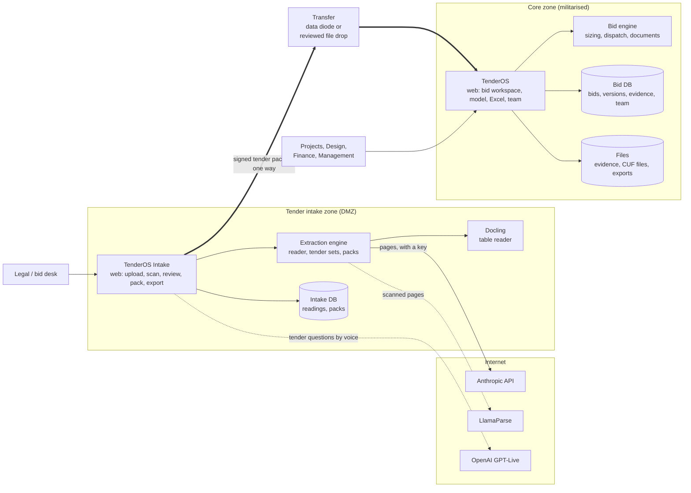
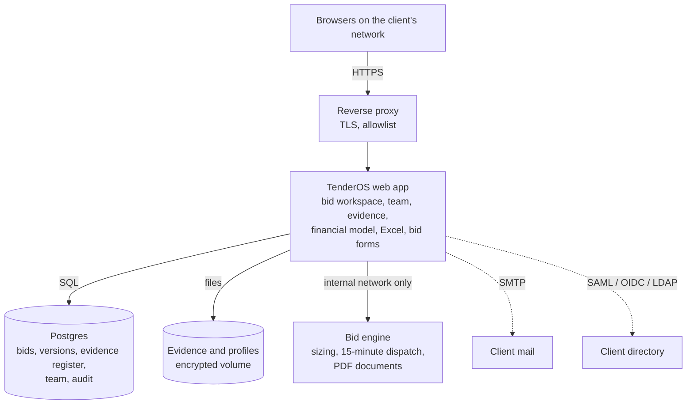

# TenderOS Enterprise: architecture

TenderOS Enterprise runs in two zones of the client's network. The **tender intake zone** (a DMZ)
reads the tender with cloud models. The **core zone** (the client's militarised network) holds the
bid, the sizing engine and the financial model, and never talks to a cloud model. Documents move
from the DMZ into the core as a signed package; nothing moves out.

This document covers the zones, what runs in each, how data crosses, how the application is
installed and patched, and how it is secured. The sizing engine is described by its interface
only.

## 1. Zones

| Zone | Holds | Talks to | Never holds |
| --- | --- | --- | --- |
| **DMZ** | The tender documents, the reading (every value with page and quote), tender packs, amendments and clarifications, the search index | Anthropic (the reader), LlamaParse (scans), OpenAI (tender questions by voice), the client's users | Bid inputs, costs, CUF files, the sizing, the financial model |
| **Core** | Everything about the bid: inputs, evidence, profiles, sizing results, the financial model, bid forms, the team | The client's users, the client's SMTP and directory; nothing on the internet | Cloud API keys; any outbound connection |

Both zones run the same TenderOS release. A deployment flag (`TENDEROS_ZONE=intake` or `core`)
decides which parts are on:

* In the DMZ: tender upload and reading, tender sets, packs, review, voice questions on the
  tender, the export. Bid steps are off.
* In the core: everything from the tender step onward; upload and reading are off; the cloud
  clients are not configured and the network policy blocks them anyway.

## 2. The tender intake zone

| Part | What it does |
| --- | --- |
| Intake web app | Upload a tender or a set (RfS, amendments, clarifications, PPA/PSA); the scan screen; the reading reviewed value by value; the tender pack; the export |
| Extraction engine | Reads the tender with the cloud model (every value with its page and quote), applies amendments to the RfS, reads clarifications, formats and the bid process; builds the pack. Without a key, the rule-based reader reads the headline fields |
| Docling | Reads the tables of amendments and clarifications; local, no internet |
| LlamaParse | Pages without a text layer (scans); optional |
| Voice questions | The bid agent answers questions about the extracted tender by voice (GPT-Live). In the DMZ it has the tender only: no bid inputs, no sizing |
| Intake DB | Readings, packs, review state, the audit of who reviewed what |

**What leaves the DMZ:** the tender package only. It holds the documents, the reviewed reading,
the pack (conditions, changes, clarifications, formats, bid process), each quote with its page,
and a manifest with checksums, the release that produced it and the reviewer's sign-off. The
package is signed with the intake zone's key; the core verifies the signature and the checksums
before importing.

**What never leaves the core:** nothing is sent back. The DMZ holds no bid data, so a compromise of
the DMZ exposes the tender (a public document) and the reading, not the bid.

## 3. The transfer

The package crosses by whichever the client runs:

* a **data diode** (one-way link) with the package dropped on the DMZ side and picked up in the
  core;
* a **reviewed file drop**: the package is copied to a quarantine share, scanned, then imported.

Either way the core's import verifies the signature, the checksums and the release version, then
creates the tender in the bid workspace with every quote linked to its page in the copied PDFs.
The import is logged with who imported it and when. A package built by a newer release than the
core runs is refused with a clear message, so the patch goes first.

## 4. The core zone

| Part | What it does |
| --- | --- |
| Web app | The bid workspace in steps (section 5), the team (assignments, pings, Team setup), the evidence register, the financial model (in the browser and as Excel with live formulas), the bid forms and letters, saved bids with versions, the audit log |
| Bid engine | A stateless service on the internal network: the sizing engine, the 15-minute dispatch of every PPA year, PDF layout. It has no credentials, no outbound access and no published port; only the web app reaches it |
| Postgres | Bids and their versions, the evidence register, team members and roles, assignments, messages, the audit log, tender packages imported |
| Files | Evidence files, CUF files as uploaded and as used, signed copies, exports; on an encrypted volume, backed up with the database |
| Reverse proxy | TLS, the client's certificate, source allowlists |

**No cloud model in the core.** The core release ships without the cloud clients configured, and
the network policy blocks outbound traffic. The voice agent, the Claude connector and the LLM
reader are intake-zone features. Everything in the core is deterministic code: the sizing engine,
the dispatch, the financial model and the document builders.

## 5. The bid workspace: steps and teams

One tender, one bid, ten steps in order. Each step has an owner, a gate (sign-off) and shows,
on every input box, whether it is filled, evidenced and signed off. A change after sign-off
reopens the step and makes a new version of the bid.

| Step | Owner | What is on it | Gate |
| --- | --- | --- | --- |
| 1 Tender | Legal | The imported package: conditions with quotes, amendments, clarifications, formats; the checklist against the bid | Conditions signed off |
| 2 Bid inputs | Projects | Contracted MW, dates, supply profile, planning choices (Peak Hours, shortfall), market sale, the assumptions register | Every input evidenced and signed off |
| 3 Design | Design | Sources and limits; sites and co-location (solar + BESS, wind + BESS, one or two pooling stations); the schematic with losses summed at the pooling station; profiles with their CUF files and the 25-year justification; deviation settlement inputs; the studios | Design signed off |
| 4 Finance inputs | Finance | Financing, construction schedule and IDC, working capital, repayment method and sculpting, refinancing, tax and depreciation | Financing case signed off |
| 5 Sizing | Design | The sizing engine on the signed-off inputs | Run |
| 6 Results | All | The plant, the compliance table, the dispatch charts, the 15-minute dispatch | Review |
| 7 Financial model | Finance | Monthly construction then yearly operations; the traceable model; Excel with live formulas | Model signed off |
| 8 What-if | Management | The sized plant as the base case; levers to reach a tariff on bid day; sensitivities | Tariff decided |
| 9 Bid forms | Legal | Formats filled and reviewed, letters, the bid pack with the evidence register | Each format reviewed |
| 10 Submission | Management | The bid frozen as a version: what was submitted, by whom, when | Frozen |

The team features sit across the steps: any box can be assigned, pinged with @mentions, or
answered with a value; Team setup holds the people, their teams, titles and the steps they cover.

## 6. Data flow inside the core

1. **Import** creates the tender from the package. Terms (capacity limits, floors, peak hours,
   permitted sources, sale rules, term) come from the reviewed reading; each carries its quote.
2. **Inputs** are entered on steps 2 to 4 by their teams, with evidence attached to each box and a
   sign-off per step. Benchmarks fill what is empty, marked as benchmarks.
3. **Sizing** sends the signed-off inputs to the bid engine and gets back the plant, the tariff,
   the energy by year and the hour-by-hour dispatch of the modelled years.
4. **Dispatch** runs every PPA year in 15-minute blocks and checks every floor.
5. **The financial model** runs in the browser from the sizing's energy: monthly from financial
   closure to commissioning (drawdowns, IDC), then yearly for the PPA term (revenue, penalties,
   DSM charges, O&M, working capital, debt by the chosen method, tax, DSCR, IRRs). The Excel
   workbook rebuilds the same model as formulas, with the dispatch sheets feeding the energy.
6. **What-if** starts from the sized plant and the model, and changes levers instantly.
7. **Bid forms** are filled from the bid; the bid pack carries the evidence register.
8. **Submission** freezes the version.

Every write of a bid, a sign-off, an evidence file, an export or a sizing is an audit row with
the user and the time.

## 7. The sizing engine (interface only)

The engine is jouleWise's proprietary component. It is delivered as a container image in the
core release, and its internals are not documented for clients. Its interface is:

| | |
| --- | --- |
| **In** | The tender's supply rules (floors by hour, month or block; peak hours; penalties; sale rules), the sources allowed with their limits and costs, hourly profiles, losses, the battery's parameters, financing parameters, the PPA term, an optional seed |
| **Out** | The plant (MW and MWh of each source), the tariff, the energy delivered and sold by year, the shortfalls by rule and year, the hour-by-hour dispatch of the modelled years, timing |
| **Properties** | Deterministic: the same inputs give the same plant. Runs in one to two minutes on 4 CPU cores for a 25-year case. No internet, no credentials, no state between runs |

Clients see what the engine decided and why it is compliant (the compliance table, the dispatch
sheets with formulas), not how it searched.

## 8. Installation and patches (AMC)

**Installation** is an offline bundle: the container images, the database migrations, the
compose files, the proxy configuration and an installer script. The client's IT loads the images
from the bundle, sets the environment (database password, session secret, SMTP, directory, zone)
and starts the stack. No image is pulled from the internet. The installer verifies the bundle's
checksums against a signed manifest before loading anything.

**Patches** come from jouleWise under the AMC as signed bundles:

1. jouleWise builds a release, runs the test suite, and produces `tenderos-<version>.bundle`: the
   images, the migrations, a changelog, and a manifest signed with jouleWise's release key.
2. The bundle reaches the client by the agreed channel (download from the client's DMZ, or
   media) and is copied into the core by the same transfer as the tender packages.
3. The client's IT runs `tenderos-patch apply tenderos-<version>.bundle`. It verifies the
   signature and checksums, backs up the database and the files, loads the images, applies the
   migrations, restarts the services and runs the health check. On a failed health check it
   rolls back to the previous images and the backup.
4. The patch is logged (version, who applied it, when, result) and shows on the About page.

The patch tool is part of the release. A patch never needs a jouleWise engineer inside the core:
the client's IT applies it, and jouleWise supports over the client's chosen channel. For the
intake zone, the same bundle is applied the same way.

## 9. Security

| Concern | Measure |
| --- | --- |
| Bid data confidentiality | The core has no outbound connection and no cloud client; the engine has no credentials; evidence and files on an encrypted volume; backups encrypted |
| Access | The client's directory for sign-in (SAML/OIDC or LDAP), tabs and steps granted per user, super admin per tender; sessions expire |
| Integrity | Every bid change is a version; sign-offs and submission freeze; the audit log is append-only and exportable |
| Transfer | Packages signed by the intake zone and verified by the core; checksums on every file; release version checked |
| Patching | Signed bundles, verified before loading; backup before and rollback after |
| Intake zone | Internet access limited to the model providers by allowlist; the tender documents are the only data; no bid data ever stored there |
| Secrets | Environment variables on the host, never in the repository or the bundle; cloud keys only in the intake zone |

## 10. What is the same as Demo 2, and what changes

| | Demo 2 | Enterprise |
| --- | --- | --- |
| Deployment | One VM, one zone, internet | Two zones; the core air-gapped; offline bundles |
| Reading the tender | In the same app, with cloud models | In the intake zone only; a signed package into the core |
| Voice agent, Claude connector | Drive the bid | Answer tender questions in the intake zone; off in the core |
| Navigation | Tabs per product with steps | One bid in ten steps with owners and sign-offs; input tabs per team |
| Finance | 25-year yearly model, IDC as a % | Monthly construction with IDC and drawdowns, then yearly; working capital; repayment methods, sculpting, refinancing |
| Design | One site or separate sites | Co-location chosen per battery; schematic with losses at the pooling station; deviation settlement per CERC |
| Evidence | Files on assignments | Evidence on every input; CUF files downloadable with the 25-year justification; an evidence register in the bid pack |
| What-if | A separate tab with defaults | Opens on the sized plant; tariff levers for bid day |
| Patches | `git pull` and rebuild | Signed bundles applied by the client's IT, with rollback |

The code base is one: the same release runs both zones with a zone flag. The features list is
`docs/enterprise/FEATURES.md` and `FEATURES.xlsx`.
