# TenderOS user manual · SECI CfD-I bid

*The CfD Bid tab, step by step: what is on each screen, what every button and box does, and what
to click. Pictures are of the demo installation (SECI CfD-I, RfS No. SECI/C&P/IPP/13/0002/26-27
dated 15.07.2026, 1,000 MWh of assured peak supply, Amendments 01 to 03 in force).*

The tab follows the SECI RTC tender tab exactly: the same sidebar, heading tools (Save, Team,
Open, Reset inputs), step chips with the owning team, boxes with pings, evidence and feedback, the
Talk to the bid agent button, Save and Open to the library. See the RTC manual's section 0 for
those; this manual covers what is different: the tender and its eleven steps.

---

## What the tender asks

SECI wants 1,000 MWh of firm evening supply a day (500 MW for 2 hours) from ISTS-connected RE
projects with storage. You do not sign a PPA: you sell the power on the exchange every evening,
and SECI's CfD Pool settles the difference between the market price and the **strike price** you
bid, so that you net the strike price on every kWh. You must build a battery of X MW / 2X MWh for
X MW contracted, commission it within 15 months, bring RE online within 36 months, and sell 2 MWh
per MW every day in two hours you choose between 18:00 and 24:00, for 15 years.

## The CfD tender in simple terms

**What SECI is buying.** Not round-the-clock power, just the evening peak. For every MW you
contract, you put 2 MWh into the grid every evening, in two hours of your choosing between 6 pm
and midnight. SECI wants 500 MW of this, so 1,000 MWh an evening in all. A group bids 50 to
150 MW.

**How you get paid: the "Contract for Difference".** You do not sell to SECI. You sell your
evening energy on the power exchange at whatever the market price is that evening. SECI's CfD
Pool then tops you up or takes the excess, so that you always end up with your bid price, the
**strike price**:

* the market clears below your strike price: the Pool pays you the difference;
* the market clears above it: you pay the difference into the Pool.

The exchange and the Pool together give you a fixed price per kWh for 15 years, and SECI never
buys the power itself. The auction is on the strike price, lowest wins. The earlier price ceiling
was removed by Amendment-03, and the earlier slab sharing of gains was replaced by this full
pass-through.

**What you must build.** A battery of at least 1 MW and 2 MWh per contracted MW, ready 15 months
after the Effective Date, and your own solar or wind by month 36. Until then you may charge the
battery entirely from green power bought on the market; after month 36 at least a quarter of the
energy must come from your own renewable plant, more if you do not use group-company plants.

**What happens if you miss.** The obligation is also measured by the week: 14 MWh per MW. Up to
10% short is free. Beyond that, each missed kWh costs 1.5 times the gap between the week's
highest evening market price and your strike price, and you lose that evening's revenue. You
also give SECI a letter of credit sized on the strike price.

**Money up front.** An earnest money deposit, then a performance bank guarantee within 20 days
of the award, SECI's administration charges, and a net-worth and liquidity test. No plant is
needed to bid; you qualify as a company.

**Why bidders like it.** Fixed revenue like a PPA, but you keep selling on the market, so there is
no discom payment risk, and the battery earns on the peak where prices are highest. The risk is
the strike price you quote: too low and the returns are thin, too high and you lose the auction.
That is what this tab sizes, prices and lets you test with What-if. Step 01 carries the same
explanation with a three-evening worked example, every claim linked to its clause.

---

## Step 01 · What is a CfD *(Tender / Legal)*

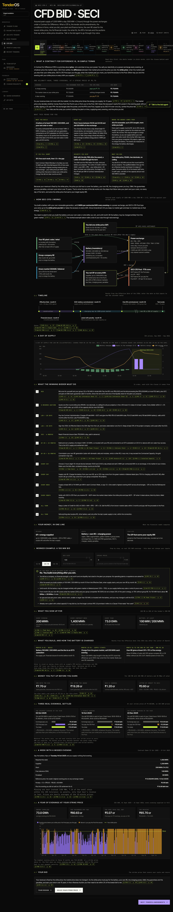

**Purpose.** The whole tender in plain words before any number. Read it first.

**1 · What a Contract for Difference is, in simple terms.** A page a non-finance reader follows: a
CfD is a promise about price, not a promise to buy; the three-evening table at ₹5.70 (a cheap
evening, the market at the strike price, a dear evening) showing what the exchange pays, what the
Pool pays or takes, and that you keep ₹5.70 every time; why SECI does it; what you build; what you
do every day; where the energy may come from and the 25% / 75% / 50% limits; the weekly 10%
tolerance and the 1.5× penalty; the Letter of Credit; what you bid and how the auction works; the
15-year term. Every sentence carries a chip (*Amd-03 p. 5*, *CfDA p. 40*): click it to open the
page.

**1a · The tender in simple terms.** The same six paragraphs as the chapter above (what SECI
buys, how you are paid, what you build, what a miss costs, the money up front, why bidders like
it), each with the clause chips behind it.

**2 · The tender as a picture.** The flow of energy and money (your RE, group RE and the green
market charge the battery; the battery and wind supply the exchange; the Pool settles against the
strike price), the timeline from the Effective Date to the end of the term, a day of supply on
IEX evening prices, your obligations in order.

**3 · Worked example.** Pick **50 / 100 / 150 MW** and a strike price: what you sign up for, what
you build and how the battery is charged in each phase, the money put up before revenue, three
real IEX evenings settled, a Contract Week with a missed evening, a year of evenings.

*Nothing to enter here.* Click **Next**.

---

## Step 02 · Tender & amendments *(Tender / Legal)*

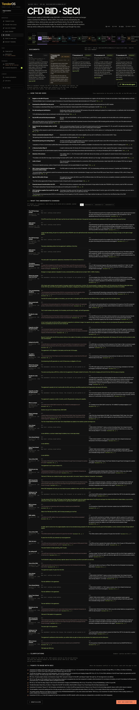

**1 · Documents.** The RfS of 15.07.2026 (it replaces the one of 17.04.2026), the standard CfD
Agreement (not provided to the demo: its quotes are kept from the standard text), Amendment-01
(17.07.2026), Amendment-02 (03.08.2026) and Amendment-03 (08.10.2026). **Open the PDF** on each
card.

**1.1 · How the bid goes.** From registration on ISN-ETS to the RfS cost and bid fee, the pre-bid
meeting, the bid with the EMD, evaluation, the financial bid, the e-Reverse Auction, the LoA, the
PBG and Contract Administration Charges within 20 days, the CfDA within 30 days, financial
closure, the SCD; each with its page.

**1.2 · What the amendments changed.** All 37 changes (4 in Amendment-01, 11 in Amendment-02, 22
in Amendment-03) as the clause stood and as amended, quoted, with the page link and one sentence
on what it means for you. Filter **All / Amendment-01 / Amendment-02 / Amendment-03**. The big
ones: the battery is now mandatory and yours (Amd-02), the RE may come 36 months in with 75% of
charging power from the market meanwhile (Amd-02), the settlement is full pass-through so you
always net the strike price (Amd-03), the term is 15 years (Amd-03), the ₹5.80 ceiling is gone
(Amd-03), TAM and G-TAM are allowed markets (Amd-03).

**1.3 · Clarifications.** None issued so far.

**1.4 · Points to raise with SECI.** Ten places where the documents conflict or are unclear,
each with the page to cite (Amendment-01's 50:50 sharing above ₹10 superseded by Amendment-03's
full pass-through; RfS 7.1 on a remote battery against the CfDA's co-location; the "longer CfDA"
for existing projects that points to a clause reading "Not used"; and others).

---

## Step 03 · Bid conditions *(Tender / Legal)*

**2 · Bid conditions.** All 251 conditions in eleven groups (Scheme and bid, Bid documents,
Auction, Daily supply, CfD settlement, Plant, Energy sourcing, Dates, Bid security and charges,
Penalties and security, Eligibility): the rule in one line, the quote word for word, the document,
clause and page link. Badges: *As issued*, *Amended · Amd-0x*, *Replaced · Amd-0x* (the original
is kept with **As issued** under it), *Documents differ* (three: the RfS and the CfDA disagree;
the model follows the CfDA, which prevails). Filter **All / Amended / Differ / RfS / CfDA**.
**Assign** hands a condition to Legal; their reading comes back through the Team panel and shows
under the condition.

---

## Step 04 · Bid inputs *(Projects)*

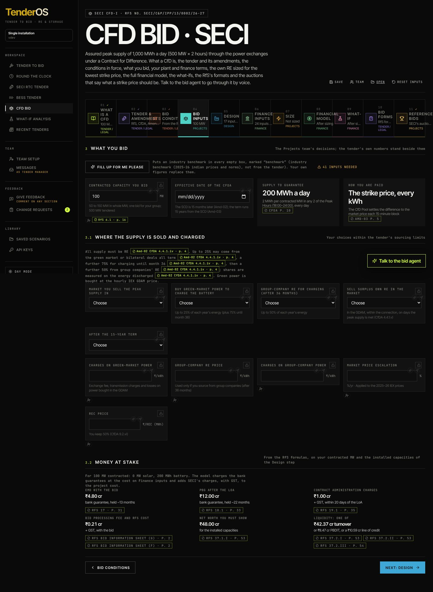

**3 · What you bid.** **Contracted capacity you bid** (50 to 150 MW in whole MW, one bid for your
group). **Effective Date of the CfDA**: every date follows it on the strip beneath (LoA 30 days
before, documents and PBG due 20 days after the LoA, financial closure 6 months before the SCD,
the SCD at 15 months, the last day with penalty 3 months later, the PBG valid to SCD + 6 months,
the RE deadline at 36 months, the end of the term 15 years after the SCD).

**3.1 · Markets and sourcing.** **Market you sell the peak supply in** (DAM and RTM are brown
markets and earn RECs, GDAM is green and does not); **Buy green-market power to charge the
battery** (up to 25% of the year's energy, plus 75% until month 36); **Group-company RE for
charging** after month 36 (up to 50%) with its price and charges; **Sell surplus own RE in the
market**; **After the 15-year term** (nothing, or keep selling at market prices for a number of
years); the charges on bought power, the market price escalation, the REC price.

**Shortfall policy** (3.1) decides how the plant is sized against the daily 2 MWh per MW:
* **Meet every day** (the default): no shortfall on any day of any Contract Year. The optimiser
  keeps only own-RE sizes that meet the supply within the sourcing limits and picks the cheapest
  of them; when none does, the least short. Size shows "2 MWh/MW every day" as a check that fails
  while any day is short.
* **Pay the penalty**: a day may fall short when that is cheaper than more plant. The shortfall
  beyond 10% in a Contract Week costs 1.5 × (the week's highest evening price − the strike
  price), and that evening's revenue is lost (CfDA 4.4.3). The optimiser then sizes on the strike
  price alone, which already carries the penalty and the lost revenue; Size shows the short days
  and the penalty over the term as information ("allowed by your policy"), not as a failure.
The note under the choice says which reading is in force; the Size step's optimiser message says
which policy sized the plant.

**3.2 · Money at stake.** What the RfS asks of this bid on the installed sizes: EMD, PBG, Contract
Administration Charges, the RfS cost and bid fee, net worth, and the liquidity test (turnover,
PBDIT or a line of credit).

---

## Step 05 · Design *(Design)*

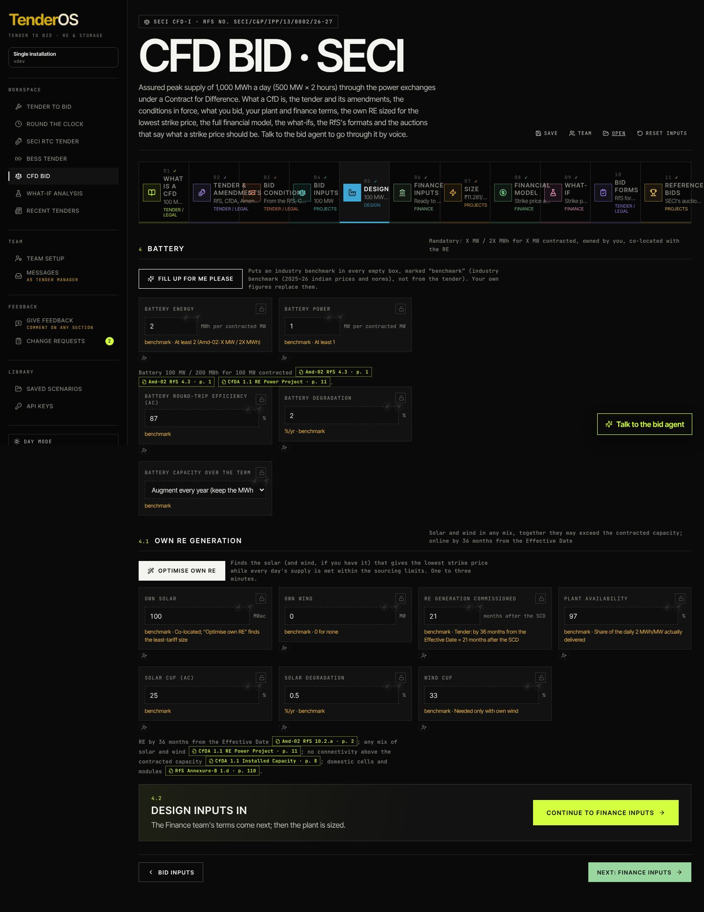

**Fill up for me please** puts industry benchmarks in every empty box, marked until you replace
them.

**Purpose.** The plant behind the bid: the battery the tender mandates, the own RE that charges
it, the losses to the billing meter and the site layout. The chip says how many inputs are still
needed; the tender sets the battery's minimum, nothing else.

**4 · Battery.**
* **Size.** **Battery energy** (MWh per contracted MW, at least 2 usable), **Battery power** (MW
  per contracted MW, at least 1), **Extra battery for evening sale** (see below). The note under
  the boxes gives the plant for your contracted MW, the **discharge duration** (energy ÷ power,
  hours) and, when a state-of-charge window is set, the usable energy within it: the tender's
  2 MWh per MW must be usable, so with a 10–90% window the nameplate has to be 2.5 MWh per MW; the
  note and the Size check say so.
* **Operation.** **Round-trip efficiency** with where it is quoted (the Losses section below sets
  the point; the model applies the round trip at the 33 kV bus), **Minimum** and **Maximum state
  of charge** (usable = (maximum − minimum) × nameplate; empty means the whole nameplate is
  usable), **Battery degradation**, **Battery capacity over the term** (augment every year, or let
  it fade).
* **Costs.** Capex per MWh (all-in), O&M per MWh, the yearly decline of augmentation cost.

**4.1 · Own RE.** **Optimise own RE** finds the solar (and wind, if you have it) that gives the
lowest strike price under your shortfall policy; it is offered here and on Size. **RE generation
commissioned** (months after the SCD, at most 21) and **Plant availability**, then one card per
source:
* **Own solar.** **Own solar** (MWac), **CUF (AC)** with where it is measured (the hint names the
  point; change it under Losses), **DC:AC ratio** (MWp = MWac × DC:AC; the hint converts the capex
  per MWac to ₹ cr/MWp; at a given AC CUF the hourly shape is pinned by the CUF, so the ratio
  changes the cost and the studio's design, not the typical profile), **Solar degradation**,
  **Capex per MWac**, **O&M per MWac**.
* **Solar plant studio** opens the layout and cost build-up (modules, mounting, string or central
  inverters, ₹/Wp); **Use this cost** writes the capex and the DC:AC into the boxes and the card
  notes "From the studio" with the design summary.
* **Own wind.** **Own wind** (MW), **CUF**, **Wind degradation** (0 by default), **Capex per MW**,
  **O&M per MW**; the **Wind farm studio** (turbines by make, the site's CUF and the farm cost)
  writes the capex and the CUF likewise.
* **Profiles** on each card. The table lists the hourly profiles available (the typical shape
  tuned to the CUF, the library's measured profiles, your uploads) with their quality, CUF,
  monthly CUFs, measuring point, period and plant MW; **Use** picks one, **Upload file** adds your
  own 8,760-hour file, **Library (n)** opens the list. The chosen profile is scaled to your CUF and
  redrawn month by month if you drag the monthly CUFs; the model simulates every day of the term on
  it. Under *Profile on screen* you see the heat map, the monthly CUFs and a week, with the CUF by
  year after degradation.

**4.3 · Losses to the billing meter.** Off until you click **Model the losses to the billing
meter**; without it every figure is at the meter, as before. On, tabs **Solar / Wind / Battery**
show, for each technology, the chain of stages from the measuring point to the 33 kV bus (inverter
and WTG transformers, cables, MV transformers), each with its loss, then the shared 33/220 kV
transformer and the 220 kV line. Pick **where your CUF is measured**: the stages above that point
are already in the CUF, the ones below are applied. The model then takes the generation to the bus,
runs the battery's round trip at the bus, and applies the bus-to-meter factor to everything
injected (the day's supply, the surplus sold, the extra battery's sale); power bought in the market
or from the group is measured at the meter, so more of it is needed to fill the same 2 MWh per MW.
**Remove** switches the losses off again.

**4.4 · Site layout.** The single-line schematic of the one site: solar, wind and the battery on
one 33 kV bus with one pooling station; set the **Power transformer loss** and the **220 kV line
loss** on it, which are the shared stages of the loss chains above. The tender takes one
connection at the contracted MW, so there is no split-site option here.

**4.5 · Continue.** The bar counts the inputs still needed and offers **Fill up for me please**;
**Continue to Finance inputs** moves on.

---

**Extra battery for evening sale.** Beyond the tender's 2 MWh per MW you may add battery whose
only job is to sell in the evening: it is charged after the day's commitment (your own RE first,
then the green market within its limit) and, once the day's supply is met, discharged in the
dearest evening hours outside your two peak hours, within the connection, at the sell market's
price. The Pool does not settle it, so it keeps the market price. Its capex, O&M, EMD and PBG
follow the installed MWh, and the What-if step shows whether it lowers the strike price. It pays
only while evening prices hold up, which is the storage-flood case on F.9. 0 means none.

*What the battery must be.* The tender's 2 MWh per MW is what must reach the billing meter. The
model asks for nameplate = 2 ÷ (state-of-charge window × the share that reaches the meter) and
power = 1 ÷ that share, rounded up to 0.05: with a 10–100% window 2.25 MWh per MW, and more once
the losses to the meter are modelled. **Fill up for me please** sets both when yours are below.
The round-trip efficiency does not change the size: it changes the charging power bought (1 ÷
efficiency units in for every unit out). Degradation is met by augmentation (annual, the default:
the faded MWh are replaced each year and costed; or on a schedule); with no augmentation the
Size check names the year the usable energy falls below the need.

## Step 06 · Finance inputs *(Finance)*

**Lender's minimum DSCR.** The floor your lender sets (1.1 by default). It does not change the model; the Minimum DSCR tile on the Financial model, What-if and F.5 Returns turns red below it.

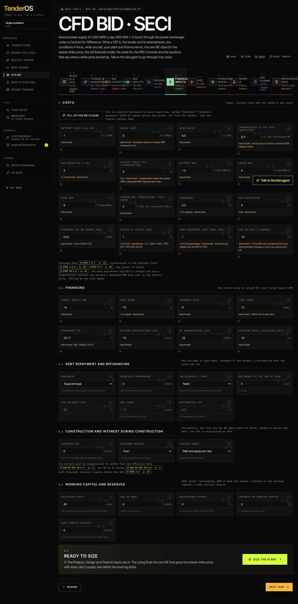

**5 · Costs.** Battery capex (₹ cr/MWh, all-in), solar and wind capex, the line to the ISTS
substation, pre-operative and IDC, the battery price fall for augmentation, O&M by source, the
fixed scheduling and admin cost, insurance, O&M escalation, the exchange fee, the Letter of
Credit cost, the bank guarantee cost, GST on SECI's charges.

**5.1 · Financing.** Target equity IRR, debt share, interest rate, loan tenor, corporate tax,
depreciation lives, the discount rate.

**5.2 · Debt repayment and refinancing**, **5.3 · Construction and interest during
construction**, **5.4 · Working capital and reserves**: the same boxes as the RTC tender's Finance
inputs (six repayment methods with their extra box, moratorium, instalments a year, refinancing
year, rate, tenor and fee; construction months, drawdown profile, funding order; receivable days,
O&M in hand, spares, interest on working capital, debt service reserve).

**5.4a · Finance team's inputs.** The ten closed groups of the finance team's list (timeline,
construction and commissioning, generation and revenue, operating cost, debt, quasi-equity and
mezzanine, guarantees, tax and depreciation, returns, sensitivity for the reverse auction); each
off until filled. The commercial operation date defaults to the battery's SCD, 15 months from the
Effective Date. The groups are explained in the RTC tender manual's chapter **More inputs (finance
team)**; they work the same here, on the CfD model.

**5.5 · Size the plant.** The bar lists what is still missing; **Size the plant** runs the
optimiser and opens Size.

---

## Step 07 · Size *(Projects)*

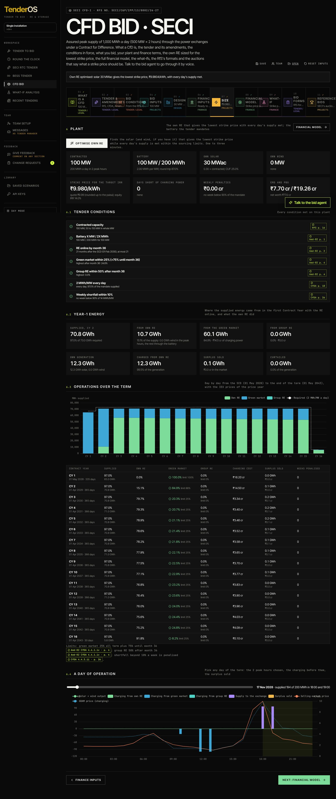

**6 · Plant.** While it runs the chip says *Optimising n/N* and **Stop** halts it (seconds to a
minute: the model simulates every day of the 15 years for each candidate size and prices each
with the full financial model). The banner then says what it found. Tiles: **Contracted**,
**Battery**, **Own solar**, **Own wind**, **Strike price to bid** (the full financial model's
price, the same figure as on the Financial model step and in the workbook, with the quote rounded
up to the paisa), **Days short of charging power**, **Weekly penalties**, **EMD and PBG**. **Optimise own
RE** reruns it; **Financial model** jumps on.

**6.1 · Tender conditions.** Seven checks, met or not, each with its page: capacity 50–150 MW,
battery X MW / 2X MWh, RE online by month 36, green-market share within 25% (+75% until month
36), group RE within 50% after month 36, 2 MWh/MW every day, weekly shortfall within 10%.

**6.2 · Year-1 energy.** Where the supply came from in the first Contract Year with the RE
online: own RE, the green market, group RE; own generation, charged from own RE, surplus sold,
curtailed.

**6.3 · Every Contract Year.** The table of Contract Years (April to March from the SCD): required
and delivered energy, the shares by source against the limits, **Charging bought** (what you pay
the exchange and group companies), **Own RE at cost** (the energy your own plant put into the
battery, valued at what the plant costs you per unit: the RE capex annualised at the discount
rate over its life plus O&M, over the energy it makes, about ₹2.2/kWh on the benchmarks; the
total of both beneath), surplus sales, weeks with a penalty. The exchange bill falls once your
own RE is in (for example ₹16 cr in CY1 to ₹3 cr in CY3 on the benchmark bid) but the total
hardly moves: the own-RE cost sits in the depreciation, interest and O&M lines of the financial
model instead of the exchange bill.

**6.4 · A day's operation.** Pick any day: the hourly chart of solar and wind, charging from own
RE, the market and group RE, the battery's discharge in the two peak hours, the sale, and the
prices of the day. **Hourly / 15-minute blocks** switches the same day to 96 blocks, with the
battery's stored energy as a dotted line: each hour of the plan is split into four blocks that
keep its energy (solar and wind along the hour's trend, own-RE charging following the generation,
bought charging and the discharge even over the hour; the IEX prices are hourly, so the four
blocks of an hour carry one price).

**6.5 · 15-minute dispatch, 15 years.** The whole term in 15-minute blocks, about 526,000 of
them, the scheduling resolution of the grid code. **Compute the 15-minute dispatch** runs it in
the browser (a second) and shows four tiles (blocks dispatched, peak blocks within the 10%
tolerance, the highest charging against the battery's rating, the state-of-charge range) and a
table by Contract Year: blocks, peak blocks within and below the tolerance, delivered energy,
charging by source, surplus sold, the highest charging, blocks where a steep solar ramp packs the
hour's charging over the rating, the state of charge. Every Contract Year's totals equal the
model's; what the blocks add is the shape inside the hour. Two downloads: **ZIP of CSV** (one
file per Contract Year with one row per block, the summary by Contract Year and by month, the
inputs, a README; about 5 MB) and the **15-year dispatch workbook** (About, Summary, Monthly,
then a sheet per Contract Year with its 35,040 blocks; about 45 MB, half a minute to build). Each
block row carries: peak flag, solar and wind at the bus, charging from own RE, the green market
and group RE, the battery's discharge, stored energy and state of charge, wind supplied directly,
delivered against the supply due and the shortfall, surplus sold, curtailment, the selling-market
and GDAM prices.

---

## Step 08 · Financial model *(Finance)*

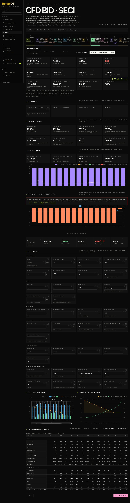

**5 · Bid strike price.** The tiles come from the same financial engine as the RTC tender, fed
with the CfD operations: **Strike price to bid** (the price that gives the target equity IRR;
the same figure as on Size, with the fast screening model's figure beside it for reference), **Equity IRR**, **Project IRR**, **Minimum DSCR** (red
below 1.1: year 1 may run on bought charging power until the RE is online), **Project cost** (per
contracted MW, with the LCOE), **Year-1 supply**, **Year-1 operating cost** (charging power and
O&M), **Letter of Credit to SECI** (nil when the strike price is above ₹10), **CfD Pool, a year**
(who pays whom at this price), **Weekly shortfall penalty**, **Charging power over the term**,
**Equity payback**. Σ on a tile opens the traceable model at that number. **Trace the model**
opens the explorer; **Download financial model (Excel)** builds the workbook with Cover, Live
model, Construction, Profit and loss, Cash flow, Balance sheet, Debt schedule, Depreciation and
tax, Working capital and Sensitivity, every number a formula on the blue inputs.

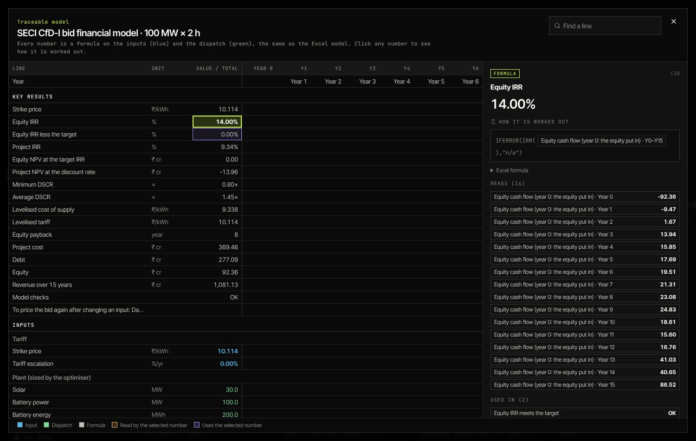

**Why "Project NPV at the discount rate" can be negative.** The strike price is solved so that
the *equity* earns the target IRR (14% by default). The project NPV, on the Key results of the
workbook and in the trace, discounts the *unlevered* project cash flows (before debt) at the
**Discount rate (LCOE / NPV)** of F.1, 10% by default. With 75% debt at 9%, equity reaches 14%
while the project as a whole earns about 10% or a little less, so a 10% discount rate sits just
above the project IRR and the NPV comes out slightly negative (for example −₹13.96 cr on a
₹660 cr project). That is not a loss: it says the project's return is below the discount rate
you chose, not below your cost of capital. Read it against **Project IRR** on the same tiles:
the NPV is zero when the discount rate equals the project IRR, positive below it, negative above
it. To judge the project on its own, set the discount rate to the blended cost of capital (debt
after tax and equity in their shares, about 8 to 9% on the defaults), or read **Equity IRR** and
its NPV at the target, which is what the auction price is built on. The LCOE uses the same
discount rate, so changing it moves the levelised cost as well.

**5.0 · Your quote.** Type the **strike price you will quote**: the equity and project IRR it
earns and the difference to the target; a warning below the target.

**5.1 · Money at stake.** Battery capex, own RE capex, the line and SECI's charges, EMD, PBG, net
worth required, equity and debt, Contract Administration Charges.

**5.2 · Revenue stack.** CfD revenue (strike price × energy), surplus RE and RECs, the penalties,
year by year.

**5.3 · The CfD Pool.** This project's net pay-in or pay-out each Contract Year at the strike
price, against the IEX evenings.

**F.1 to F.8.** The assumptions (with the tariff lock: lock the strike price to see the returns
at a fixed price; **More inputs (finance team)** opens the ten groups of 5.4a), earnings and
coverage, debt and equity cash, the construction month by month when months are set, the full
15-year table (dated from the SCD once the commercial operation date is set, with the finance
team's lines when their inputs are on; click any number for its formula; **Export CSV**), then
**F.5 Returns** (levered and unlevered, pre- and post-tax, HoldCo and promoter, the lender's XIRR
and MIRR, DSCR / FSCR / LLCR / PLCR), **F.6 Tax schedule**, **F.7 Balance sheet and cash-flow
statement** and **F.8 Reverse-auction sensitivity** (the strike price your target IRR needs when
the capex, module price, exchange rate, interest, generation case, a commissioning delay, a longer
life or the refinancing rate move; **Run sensitivities**).

**F.9 · Market prices: the path and the bid.** The exchange price never touches the strike price
itself (Amendment-03 pays it on every kWh); it reaches you only where you *buy* charging power
from the GDAM, *sell* surplus own RE, or pay a penalty (the week's highest evening price). The
chart shows two bands as a percentage of today's IEX year, one dot per year of the term: the
**midday band** (the cheapest charging hours before 18:00, ₹1.88/kWh today in the GDAM) and the
**evening band** (the two dearest hours of 18:00–24:00 in the market you sell in, ₹8.31/kWh in
the DAM). Pull a dot up or down to change that year; **Smooth** evens the path; **Flat**,
**Storage flood** (midday +3% a year, evening −3%) and **Tight grid** (evening +3%) set a named
path; **Your own path** keeps what you dragged. Every change re-runs the full financial model:
the tiles show the strike price on that path, the equity IRR, the charging bought in the first
three years (when the battery may run entirely on market power; your Contract Years table shows
the share, for example 100% in CY1, 85% in CY2, 20% in CY3) and **Merchant sales in the bid**,
the share of the strike price that rests on selling surplus RE, red above 15%. **Compare the
scenarios** runs all of them and tabulates the strike price, its gap to flat, the IRR at the
quote, the minimum DSCR, the charging cost and the merchant share; the table beneath lists each
year's bands, charging cost in ₹/kWh and ₹ cr, surplus sales and the penalty reference.

*Reading it.* On the benchmark bid the midday price matters far more through the surplus solar
you sell at midday than through charging: a storage flood (dearer midday) *lowers* the strike
price by about ₹0.80 because the surplus earns more, while without merchant sales it raises it.
If you do not want the bid to lean on merchant sales, switch them off on Bid inputs and read the
strike price again. The **Share of the GDAM you can buy in an hour** box on Bid inputs caps market
charging at that share of the hour's cleared GDAM volume (20% by default; midday GDAM clears
about 1.2–1.8 GW on thin days, so 500 MW of winners charging together would take a third of it).

*One price.* Every step, the chip, the bid agent, the bid forms, the saved bid and the workbook
carry the same strike price: the full financial model's. The fast screening model that was used
to explore sizes is shown only as a small figure beside it; the workbook's cover states the
model's simplifications (the whole capex spent before the SCD, operating years from the SCD).

---

## Step 09 · What-if *(Finance)*

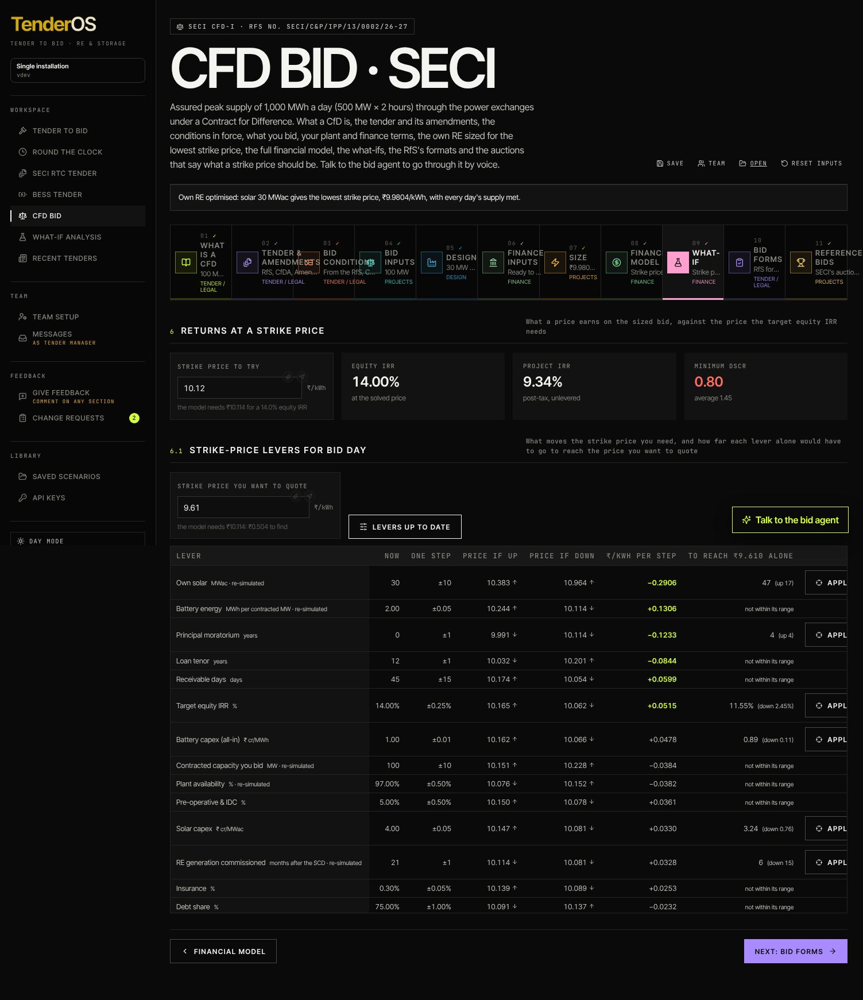

**1 · Returns at a strike price.** Type a price: equity and project IRR, DSCR.

**2 · The track to the price you want to quote.** Type the **strike price you want to quote**
and click **Plot the track**. The screen measures every lever (a minute), then plans the way
from the price the model needs to your quote: which levers to turn, how far, in what order, and
the chance of each move happening. Four tiles (the model needs, you want, where the track ends,
the chance it all comes off), a one-line verdict, a waterfall from the model's price down to the
quote, and the moves as a numbered story: the lever, from → to, a chance chip (sure, likely 50%,
a stretch 10%, a long shot, no chance), the price after the move, the chance so far, who decides
it (your board, the lender, the battery supplier, the EPC…), why it works, and how far it can
plausibly go (sure to, likely to, a stretch to, no chance past). **Apply every move to the bid**
writes them in. A quote no lever can reach, ₹1/kWh say, is said so: *Out of reach: with every
lever at the end of its chance the price is still ₹X; chance 0%*, with the list of what that
floor assumes.

*How the chance is judged.* Each lever has three bands, benchmark judgement for a 2028 project
in India (named under each move; not from the tender): where you can put it at will (sure,
100%), where it lands with normal effort or a fair negotiation (likely, 50% at the edge), what
takes luck or a hard bargain (a stretch, 10% at the edge); one stretch-width beyond that the
chance is zero. The track picks, at every turn, the lever whose next step buys the most price for
the least chance given up, orders the moves from the surest to the least likely, and prices
them for real one after another through the full model, so the price after each move is the
model's, not a straight line. The chance of the whole track is the moves' chances multiplied,
as if they were independent. Levers that are not yours to choose (the tax rate, the market's
prices) are left out.

*Freezing a lever.* When you are sure of a value (a signed battery quote, a term sheet, a board
minute on the equity target), click **Freeze at this value** on the move, or **Freeze** on the
lever's row, type the value, attach the evidence (a file, a link or a note) and confirm. The
value is written into the bid and locked, the record appears in the **Frozen levers** table
(lever, frozen value, price impact, who and when, evidence, note; the biggest impact first) with a bar that says how much of the gap to
your quote the frozen values have secured and how much is still to find, and every later track
leaves it alone and looks for the rest of the gap elsewhere. Click a bar of the waterfall to jump
to its move. The evidence also lands in the tab's evidence register. **Unfreeze**
lets the plan move it again (the value stays).

*Freezing a better value than the track asked for.* The dialog opens at the move's value, but you
type what your evidence supports. If the track asked for a battery at ₹0.59 cr/MWh and your quote
is ₹0.50, freeze ₹0.50: the dialog says what the benchmark bands make of that value (sure, a
stretch, or beyond what they allow for) and that your evidence overrides them, the price impact
in the Frozen levers table is measured through the full model at ₹0.50 (not scaled from the
suggestion), the secured-gap bar moves by that much, and the next track starts from the lower
price and needs fewer other moves.

*Not for us.* Every suggested move also has a **Not for us** button. Click it when the move is one
you will not make (say, a longer loan tenor your lender has ruled out): the lever is recorded with
the bid under **Not for us**, the track is plotted again without it and finds the gap through the
other levers, and the verdict says how many levers you turned down. **Allow again** lets the plan
use it. The bid size is never offered as a move: every cost scales with the MW, so it hardly moves
the price, and it is a decision for the Bid inputs step.

*Download What-if model (Excel).* The button is always there under the track section: with a
track plotted it builds the full financial model of the What-if case: the bid with every move applied, priced through the full model, the
same sheets as the Financial model step, plus a **What-if track** sheet with the summary, the
moves (from, to, chance, price after, chance so far, who decides, why, frozen with evidence) and
the frozen levers.

**3 · Every lever, one step at a time.** A fold at the end of the track section: the
measurements the track is built from. Open it to see the levers the track did not pick, how much
each moves the price per step, and to apply or freeze one by hand. Click **Compute the levers**
(about a minute: operations levers re-simulate the term, finance levers re-price it). One row per
input: its value now, one step, the price if up, the price if down, ₹/kWh per step, and how far
that lever alone must move to reach your price (or "not within its range"). **Apply** moves the
input there; recompute after changing the case.

*Reading the table.* The box above it says what each column means: the model needs a price for
your target equity IRR; each row moves one input one step up and one step down, everything else
as in the bid, and solves the price again; **Price if up / if down** is the price after that move
(green arrow lower, red higher); **₹/kWh per step** is the slope, bold where it matters; **To
reach ... alone** is the straight-line distance for that lever on its own. The **?** on a row
(or **Explain every lever**) opens three lines under it: what the input is, why it moves the
price (for example own solar replaces bought charging power at about ₹2.2/kWh and sells its
surplus, against ₹4 cr of capex per MWac, so the first MW lower the price a lot and the surplus
past the battery's need turns it up again), and the row's own numbers in a sentence (now, one
step up and down with the price each gives, how far it would have to go for your quote).

---

## Step 10 · Bid forms *(Tender / Legal)*

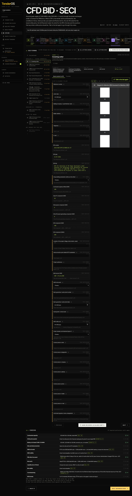

**10 · Bid forms.** The left column: **Your particulars** (asked once: company, bidding as,
address, signatory, dates, the strike price you quote, EMD instrument, substation and
connectivity, site, net worth and the liquidity route) and the RfS's 17 formats grouped by
envelope (Envelope I techno-commercial, Envelope II financial, after the award, not needed for
this bid): 7.1 Covering Letter, 7.2 Power of Attorney, 7.3A/B the EMD as a bank guarantee or
surety bond, 7.3C/D the PBG, 7.4 Board Resolutions, 7.5 Consortium Agreement, 7.6 Financial
Requirement, 7.7 Undertaking, 7.8/7.8A Disclosure and its annexure, 7.9 technology tie-up, 7.10
Integrity Pact, 7.11 the financial bid letter, 7.12 the cost estimate. Each shows how many blanks
are left. Click a format: its blanks beside the RfS page (**Blanks beside the RfS**) or **The
letter** in the RfS wording filled from the bid; **Reviewed** ticks it once read; **Assign** hands
it to Finance or Legal; a signed copy they upload appears on the format. **Use ₹x/kWh** puts the
model's strike price in the particulars. **All letters (Word) / (PDF)** and **Download bid pack
(Word)** export them.

**10.1 · Checks.** Eleven checks against the conditions: capacity, the strike price (two
decimals, no ceiling), battery, site and interconnection, EMD amount and validity, PBG and CAC,
net worth, liquidity, bid validity, the commissioning dates.

---

## Step 11 · Reference bids *(Projects)*

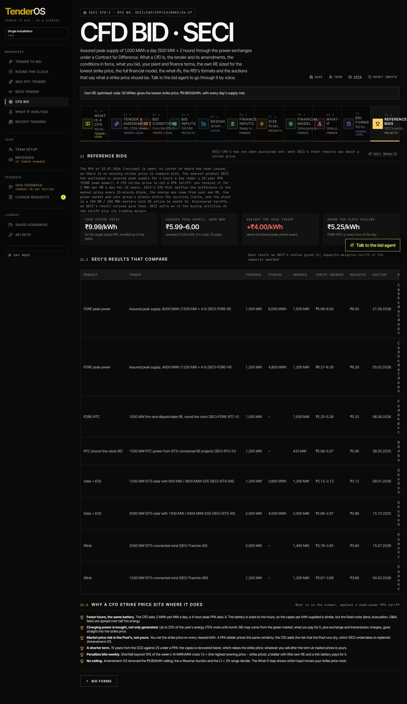

**11 · Reference bids.** SECI-CfD-I has not been auctioned yet. The tiles set your strike price
against the lowest award of the nearest product SECI has auctioned (assured peak supply, 4 hours
a day, 25-year PPA) and the round-the-clock ceiling. **11.1** lists SECI's eight results that
compare with why each does; **11.2** explains why a CfD strike price sits where it does (fewer
hours on the same battery, charging power bought, no market risk, a 15-year term, weekly
penalties, no ceiling).

---

## The bid agent

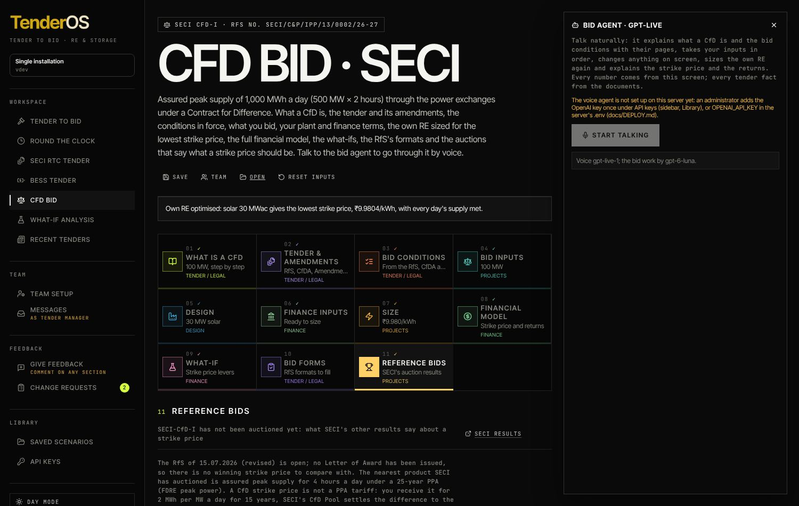

**Talk to the bid agent** (bottom right; needs the OpenAI key under API keys) opens the voice
agent with sixteen tools for this tender: it explains what a CfD is and the conditions with
their pages, reads the amendments' changes, asks for the inputs in order, sets any input, fills
the benchmarks, runs and stops the optimiser, reads the results and the financial model, and
checks a strike price you name. Every number it says comes from this screen.

---

## Quick reference: a CfD bid in ten clicks

1. **CfD Bid** in the sidebar; read **01 What is a CfD**.
2. **04 Bid inputs** → contracted MW, Effective Date, the market, the sourcing choices.
3. **05 Design** → **Fill up for me please**, then your battery and RE numbers.
4. **06 Finance inputs** → costs, financing, repayment, construction, working capital → **Size the plant**.
5. Read **6.1 Tender conditions** and **6.3 Every Contract Year** on Size.
6. **08 Financial model** → the strike price; **Download financial model (Excel)**.
7. **5.0 Your quote** → the price you will quote.
8. **09 What-if** → **Compute the levers**.
9. **10 Bid forms** → particulars, review each format, **Download bid pack (Word)**.
10. **Save** the bid; **Assign** what others must supply; **11 Reference bids** for the comparison.
