# TenderOS user manual · SECI RTC tender

*The SECI FDRE-RTC-V bid, step by step: what is on each screen, what every button and box does,
and what to click. Pictures are of the demo installation (SECI FDRE-RTC-V, RfS No.
SECI/C&P/IPP/13/0020/25-26, 1,000 MW round-the-clock, Amendment-03 in force).*

---

## 0. Getting around

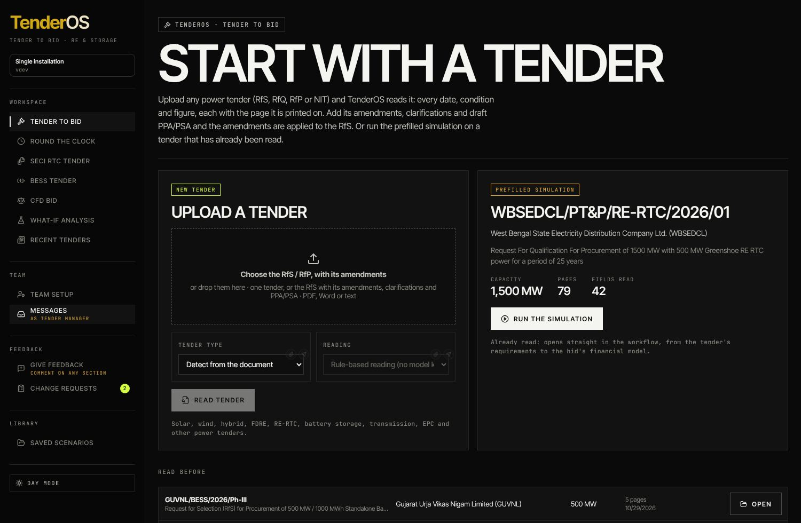

**Sidebar.** *Workspace* holds the tabs (Tender to Bid, Round the Clock, **SECI RTC tender**, BESS
Tender, CfD Bid, What-if analysis, Recent tenders). *Team* holds **Team setup** and **Messages**
(the badge is your unread count; on a demo the "View as" drop-down switches seat). *Feedback*
holds **Give feedback** (comment on anything on the page) and **Change requests**. *Library* holds
the saved scenarios. The badge under the logo shows the installation's zone and version. **Day
mode** at the bottom toggles the theme.

**The page.** Every tab is a story: a heading, a row of **step chips** (number, title, a one-line
status such as *17 inputs needed* or *₹7.458/kWh*, and the **team** that owns the step), and the
step's sections, each with an index (3.2), a title and a note on the right. Click any chip to
jump; **Next** and **Back** at the foot of the page walk the steps in order. A chip turns green
when its step is complete.

**Boxes.** An input box shows its label, the value with its unit, and a hint underneath. A grey
hint "Industry benchmark … not from the tender" means the value was filled by **Fill up for me
please** and is yours to replace. Two icons sit at a box's top-right corner when you hover:

* the **paperclip** — attach evidence (a note, a link or a file) and, for the super admin, sign the
  value off (green tick; amber once the value changes);
* the **send icon** — ping a colleague about this box (`@name`), who answers with a value you can
  fill in with one click.

A small **lock** on a box (Financials and Round the clock) freezes it so a benchmark refill or a
studio cannot overwrite it.

**Heading tools (top right).** **Save** names the bid and saves it to the library (every later
save is a version); **Team** opens the hand-off panel (assignments, answers, outbox); **Open** goes
to the library; **Reset inputs** clears the whole bid in this browser (it asks first). The green
**Talk to the bid agent** button (bottom right) opens the voice agent where it is set up.

**Where your work lives.** Everything you type is kept in this browser as you go; **Save** puts it
on the server for the team. Saved bids are opened from the library and reopened by anyone on the
team.

---

## Step 01 · Tender & amendments *(Tender / Legal)*

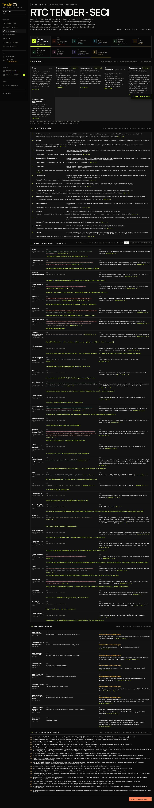

**Purpose.** Read the tender as it stands: the RfS, its amendments and clarifications, what changed
and what to ask SECI.

**1 · Documents.** The RfS and each amendment and clarification with its date; a link opens the
PDF at the page. The note says the amended rule applies and the original wording is kept beside
each condition.

**1.1 · How the bid goes.** The bid process from registration on the portal to the PPA, as the
RfS sets it out: each stage with its page reference.

**1.2 · What the amendments changed.** Every clause as it stood and as amended, quoted from the
documents. The buttons **All / Amendment-01 / Amendment-02 / …** filter by document. Each change
carries a page chip (e.g. *Amendment-03 p. 4*): click it to open that page.

**1.3 · Clarifications.** Bidders' queries and SECI's answers, with dates.

**1.4 · Points to raise with SECI.** Where the documents conflict or are unclear, each with the
page to cite: the start of the pre-bid query list.

*Nothing to enter here.* Click **Next** or the **02 Bid conditions** chip.

---

## Step 02 · Bid conditions *(Tender / Legal)*

**Purpose.** Every condition of the tender in one checklist, as it stands after the amendments.

**2 · Bid conditions.** The note counts them (*63 conditions: 25 amended, 1 removed, 1 unclear*).
Each condition shows its rule, the document and page it comes from, and under an amended rule
**RfS as issued** shows the original wording. A condition that depends on your bid (capacity
range, storage, floors) shows met / not met once the plant is sized.

**Assign** (on a condition) hands it to the Legal desk with a note; their reading comes back
through the Team panel and, once accepted, shows on the condition as "Second reading".

*Nothing to enter here.* Click **Next**.

---

## Step 03 · Bid inputs *(Projects)*

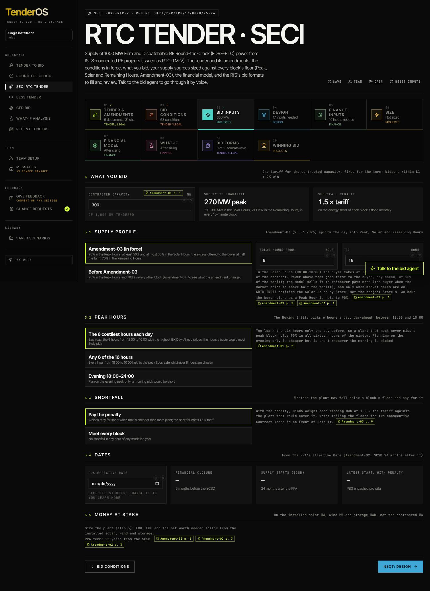

**Purpose.** What you bid and how you plan to meet the profile. These are the Projects team's
decisions; the tender's own numbers appear beside them.

**3 · What you bid.**
* **Contracted capacity (MW)** — your bid, of the 1,000 MW tendered (the tender takes 50–500 MW
  from one bidder). Everything downstream scales with it.
* *Supply to guarantee* — read-only: the MW to hold in the Peak Hours, the Solar Hours band and
  the Remaining Hours, in every 15-minute block.
* *Shortfall penalty* — read-only: 1.5 × tariff on the energy short of each block's floor.

**3.1 · Supply profile.**
* **Amendment-03 (in force)** / **Before Amendment-03** — which profile to size for: the amended
  one (90 % in the Peak Hours; 50–60 % in the Solar Hours with the excess offered to the buyer at
  half the tariff; 70 % in the Remaining Hours) or Amendment-01's (90 % peak, 70 % elsewhere), to
  see what the amendment cost.
* **Solar Hours from / to** — the hours GRID-INDIA notifies for the project's State (08:00–18:00 by
  default). Set your State's.

**3.2 · Peak Hours.** The buyer picks 6 hours a day, day-ahead, between 18:00 and 10:00. Choose
how you plan for it:
* **The 6 costliest hours each day** — the hours with the highest IEX day-ahead prices (the hours
  a buyer would most likely pick);
* **Any 6 of the 16 hours** — hold the floor in all sixteen hours: safe whatever is picked, dearer;
* **Evening 18:00–24:00** — plan on the evening only; a morning pick would be short.

**3.3 · Shortfall.**
* **Pay the penalty** — a block may fall short when that is cheaper than more plant; the optimiser
  weighs each missing MWh at 1.5 × tariff;
* **Meet every block** — no shortfall in any hour of any modelled year.

**3.4 · Dates.** Enter the **PPA Effective Date** (expected signing). Financial Closure (6 months
before the SCSD), the Supply start (24 months after the PPA) and the latest start with penalty
follow.

**3.5 · Money at stake.** EMD, PBG and net worth follow from the installed solar, wind and storage:
they fill in once the plant is sized (step 06). The PPA term (25 years from the SCSD) is shown with
its page chip.

Click **Next** to go to Design.

---

## Step 04 · Design *(Design)*

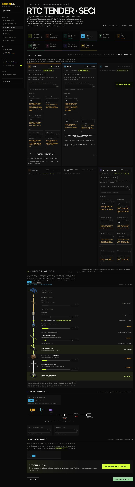

**Purpose.** The sources you have, with their capacities, parameters and costs; the losses to the
billing meter; the site layout; the market sale. The chip says how many inputs are still needed.

**Fill up for me please** (top right and at the foot) puts industry benchmarks (CERC norms,
2025–26 prices) in every empty box, marked as benchmarks; anything you type replaces them. The
tender sets none of these.

**3 · Supply sources.** One card per source. The chip *Allowed by the tender* / *Not allowed by the
tender* carries the page. On each card:
* **I have it / Optimizer sizes it / Not in my bid** — whether the source is in the bid and whether
  its capacity is fixed by you or chosen by the optimiser.
* **Capacity: optimizer may build up to** — the ceiling for the optimiser (empty: a multiple of the
  contracted MW, shown in the hint). With *I have it*, the exact MW.
* **CUF (AC)** — annual energy ÷ (MWac × 8,760 h), with where it is measured (the hint names the
  point; change it under Losses).
* **DC:AC ratio** (solar) — MWp = MWac × DC:AC; also shapes the typical profile (clipping).
* **Annual degradation**, **Capex per MWac** (the hint converts to ₹ cr/MWp), **O&M per MWac**.
* **Solar plant studio** — opens the layout and cost build-up (modules, mounting, string or
  central inverters, ₹/Wp); *Use this cost* writes the capex into the box.
* **Wind farm studio** — turbines by make, the site's CUF and the farm cost; likewise.
* **Profiles.** The table lists the hourly profiles available (the synthetic shape tuned to the
  CUF, the library's measured profiles, your uploads) with their quality, CUF, monthly CUFs,
  measuring point, period and plant MW; **Use** picks one, **Upload file** adds your own 8,760-hour
  file, **Library (n)** opens the list. Under *Profile on screen* you see the heat map, the monthly
  CUFs and a week, with **Download CUF file** (the hourly values used, as CSV), **Download 25-year
  CUF table** (the CUF by PPA year with degradation) and **Download justification (Word)** (why one
  year stands for 25: TMY method, P50/P90, variability, the CUF in year 25; enter the P50 and P90
  CUFs from your resource assessment first).
* **Battery** — power ceiling, **Discharge duration** (hours), **Round-trip efficiency** (and where
  it is quoted), minimum and maximum state of charge, **Capacity fade** per year, **Augmentation**
  (annual / one-time / none), capex per MWh and O&M per MWh.

**3.1 · Losses to the billing meter.** Tabs **Solar / Wind / Battery**. For each technology the
chain of stages from the measuring point to the 33 kV bus (inverter-duty transformers, cables,
WTG step-up transformers, MV transformers …), each with its loss, then the shared 33/220 kV
transformer and the 220 kV line. Pick **where your CUF is measured**: the stages above that point
are already in the CUF, the ones below are applied. The year-1 energy at each point is shown.

**3.2 · Solar and wind sites.**
* **One site** — solar, wind and the battery on one 33 kV bus with one pooling station; set the
  **Power transformer loss** and the **220 kV line loss**.
* **Separate sites** — a battery at the solar site and one at the wind site, each charging from
  its own site, each with its own pooling station and line: four loss boxes. The optimiser decides
  how much battery goes on each site; sizing two sites takes several minutes.
* The **single-line schematic** redraws for the choice, with the losses at each pooling station and
  the share of the bus energy that reaches the meter.

**3.3 · Sale in the market.** **Yes / No**: whether to sell what the PPA cannot take. With Yes,
**Sold at** picks the IEX market (hourly prices, average shown) or **A flat price** with a price
box; a market profile chart appears. The note quotes the tender's rule with its page.

**3.4 · Continue.** The bar counts the inputs still needed (a list of the first twelve) and offers
**Fill up for me please**; **Continue to Finance inputs** moves on.

---

## Step 05 · Finance inputs *(Finance)*

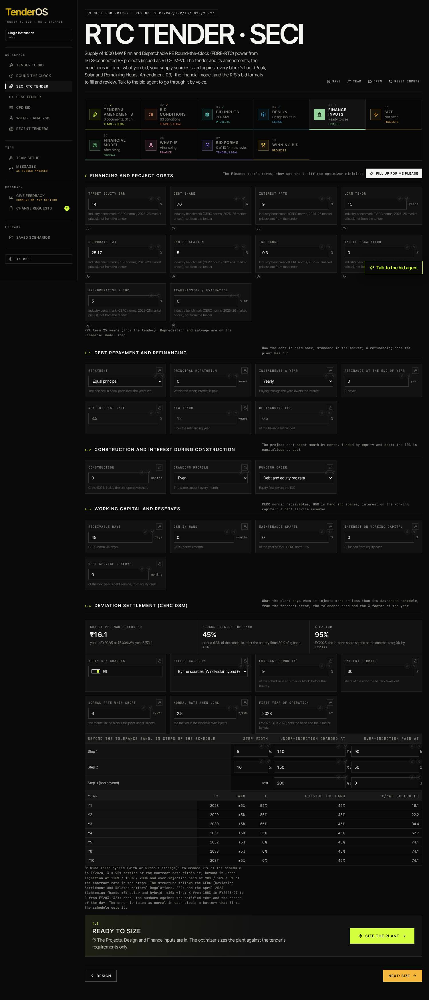

**Purpose.** The Finance team's terms: they set the tariff the optimiser minimises. The step ends
with **Size the plant**.

**4 · Financing and project costs.** **Target equity IRR**, **Debt share**, **Interest rate**,
**Loan tenor** (door to door), **Corporate tax**, **O&M escalation**, **Insurance** (% of hard cost a
year), **Tariff escalation** (0 for a flat tariff), **Pre-operative & IDC** (% of hard cost; when
construction months are set below, pre-operative only), **Transmission / evacuation** (lump sum).
**Fill up for me please** fills benchmarks here too.

**4.1 · Debt repayment and refinancing.**
* **Repayment** — *Equal principal*, *Annuity* (level debt service), *Sculpted to a DSCR* (the
  principal each year keeps the DSCR at the target; a **Target DSCR** box appears; **Lender's minimum DSCR** beside it is the floor your lender sets, 1.1 by default, below which the DSCR tile turns red), *Balloon* (a
  **Balloon share** box: that share in the last year), *Bullet* (all in the last year), *Step-up*
  (a **Principal step-up** box: the principal grows at that rate).
* **Principal moratorium** (years within the tenor; interest is paid) and **Instalments a year**
  (yearly, half-yearly, quarterly, monthly: paying through the year lowers the interest).
* **Refinance at the end of year** (0: never) with the **New interest rate**, **New tenor** (from
  the refinancing year) and **Refinancing fee** (% of the balance).

**4.2 · Construction and interest during construction.** **Construction** (months; 0 keeps the
IDC inside the pre-operative share), **Drawdown profile** (even, S-curve, front-loaded,
back-loaded) and **Funding order** (debt and equity pro rata, or equity first, which lowers the
IDC). With months set, the Financial model step shows the month-by-month table and the IDC is
capitalised as debt.

**4.3 · Working capital and reserves.** **Receivable days** (CERC norm 45), **O&M in hand**
(months; norm 1), **Maintenance spares** (% of the year's O&M; norm 15 %), **Interest on working
capital** (0: funded from equity cash), **Debt service reserve** (months of the next year's debt
service, held from equity cash).

**4.3a · Finance team's inputs.** Ten closed groups for the finance team's own modelling choices;
every one is off until you fill it, so the model's numbers do not move until you decide. Each group
is explained in **More inputs (finance team)** below; the same boxes appear under F.1 on the
Financial model step.

**4.4 · Deviation settlement (CERC DSM).** What the plant pays when it injects more or less than
its day-ahead schedule. **Apply DSM charges** (on/off); **Seller category** (by the sources, or
solar / wind / hybrid); **Forecast error (σ)** of the schedule in a 15-minute block before the
battery; **Battery firming** (the share of the error the battery takes out); **Normal rate when
short / when long** (the market price in the blocks the plant under- or over-injects); **First
year of operation** (FY; sets the tolerance band and the X factor by year). The tiles show the
charge per MWh scheduled, the share of blocks outside the band and the X factor; the step table
(editable) holds the charges beyond the band; the year table shows the band, X and ₹/MWh by year.
The note states the norms applied — check them against the notified regulation.

**4.5 · Size the plant.** The bar says *Ready to size* once every team's inputs are in (else it
lists what is missing). Click **Size the plant**: you are taken to Size and the optimiser starts.

---

## Step 06 · Size *(Projects)*

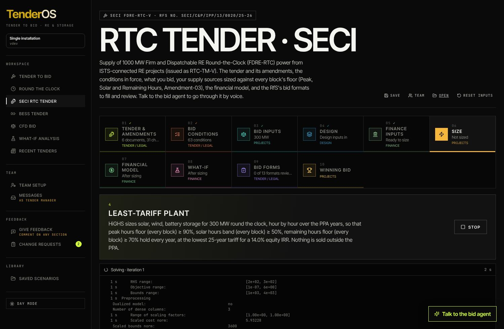

**While it runs** (one to three minutes; several for separate sites) the log shows the HiGHS
iterations and the tariff coming down; **Stop** halts it. Sizing a second time starts from the
last solution and is faster.

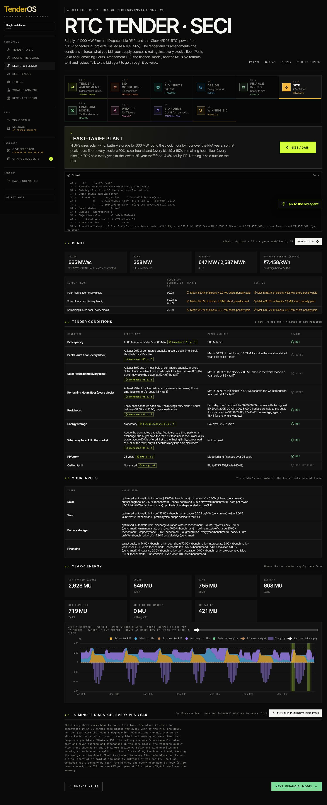

**4.1 · Plant.** The sized plant: **Solar** (MWac and MWp), **Wind**, **Battery** (MW / MWh and
hours) and the **25-year tariff (HiGHS)** — the screening tariff, with *no design below ₹x* when
the optimum is proven. The header shows the solver status, the time and the years modelled;
**Financials** jumps to the model; **Size again** reruns.

**4.2 · Tender conditions.** Met / not met / noted, now that the plant is known: the capacity
range, storage, and every block floor with the share of blocks met in year 1 and in the worst year.

**4.3 · Your inputs.** The bidder's numbers the sizing used, for the record.

**4.4 · Year-1 energy.** Where the contracted supply came from: solar, wind, battery, not
supplied, sold in the market, curtailed — in MU and as shares. The hour-by-hour chart of year 1
follows (hover an hour for its Sankey: generation → battery → meter).

**4.5 · 15-minute dispatch, every PPA year.** **Run the 15-minute dispatch** takes the sized plant
and dispatches it in 96 blocks a day for every PPA year with that year's degradation (ramp and
technical minimum in every block). When it finishes: the table of blocks met per floor and year,
and **Download (Excel)** / the ZIP of CSVs.

---

## Step 07 · Financial model *(Finance)*

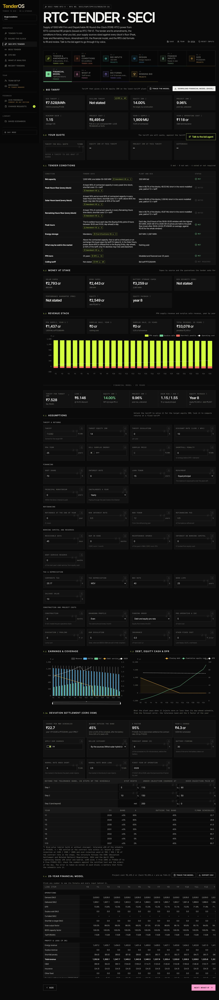

**5 · Bid tariff.** The headline tiles: **Bid tariff** (the tariff that gives the target equity
IRR on the sized plant; the HiGHS screening tariff beside it), **Ceiling tariff** (from the
tender, with the headroom), **Equity IRR**, **Project IRR**, **Minimum DSCR** (average beside),
**Project cost** (₹ cr per contracted MW and the LCOE), **Year-1 supply**, **Year-1 operating
cost**. Tiles with a Σ mark open the traceable model at that number.

* **Trace the model** opens the explorer (below).
* **Download financial model (Excel)** builds the workbook: Cover, **Live model** (every number a
  formula on the blue inputs; Goal Seek the tariff), **Construction**, **Profit and loss**, **Cash
  flow**, **Balance sheet**, **Debt schedule**, **Depreciation and tax**, **Working capital**,
  **Sensitivity** (tariff vs capex, CUF and interest rate), and a **Dispatch** sheet per modelled
  year with the hour-by-hour formulas.

**5.0 · Your quote.** Type the **Tariff you will quote**: the equity and project IRR it earns and
the difference to the target appear; below the target a warning says so. The quote is carried into
the bid forms.

**5.1 · Tender conditions.** As on Size.

**5.2 · Money at stake.** Capex by source, **Bid security (EMD)**, **Performance guarantee (PBG)**
(from the tender's per-MW amounts on the installed MW), equity and debt, equity payback.

**5.3 · Revenue stack.** PPA supply and surplus sale revenue year by year, with the penalties.

**F.1 · Assumptions.** Every financial input in one place (the same boxes as Finance inputs, plus
**Tariff** with its lock — lock it to compute returns at a fixed tariff, unlock to solve it —
**Discount rate**, **PPA term**, **Sell surplus energy**, **Surplus price**, **Shortfall penalty**,
**Tax depreciation** (WDV / straight line), **WDV rate**, **Book life**, **Salvage value**,
**Other fixed cost**). Changing any of them recomputes the model at once.

*About the discount rate.* It serves two numbers: the LCOE and the **Project NPV at the discount
rate** (Key results of the workbook, the trace). The tariff is solved for the *equity* target
IRR, so the project as a whole, before debt, earns less than that (about 10% on the defaults).
A discount rate above the project IRR gives a negative project NPV; that reports the project's
return against the rate you chose, not a loss. Set it to the blended cost of capital, or read
Project IRR and the equity NPV at the target instead.

**More inputs (finance team).** A button under the assumptions opens the finance team's groups
(the same as 4.3a on Finance inputs); see the chapter of that name below.

**F.2 · Earnings & coverage** — revenue, EBITDA, PAT, debt service and DSCR by year.
**F.3 · Debt, equity cash & DFR** — closing debt, cumulative equity cash and the delivery ratio.
**F.3a · Deviation settlement** — the DSM panel with the year-1 charge on this plant.
**F.3b · Construction** (when months are set) — the month-by-month table and chart: cost drawn,
equity, debt, IDC, closing debt; the IDC total and the gearing at COD.

**F.4 · 25-year financial model.** The full table: operations (MU, DFR, tariff), profit and loss,
working capital, cash flow, debt and DSCR, year by year. Once a commercial operation date is set
the columns read *Y1 · May 2028 – Apr 2029* instead of Y1, Y2. Lines that belong to a finance
team's input (carbon credits, O&M by source, guarantee fees, the sweep, quasi-equity and mezzanine,
repowering …) appear only when that input is on. **Click any number** to open its formula and every
input behind it; **Export CSV** downloads the table with a "Year starts" row.

**F.5 · Returns.** Equity IRR (levered) and project IRR (unlevered), each post-tax and pre-tax;
the **HoldCo IRR** and **Promoter IRR** when the Returns group is filled; the lender's **XIRR**
(dated draws and repayments) and **MIRR** (at the reinvestment rate); minimum **DSCR**, **FSCR**
(fixed costs and guarantee fees added to both sides), **LLCR** (cash to the end of the loan over
the debt) and **PLCR** (cash to the end of the project over the debt). With mezzanine or
quasi-equity, a Funding tile shows the split.

**F.6 · Tax schedule.** Profit before tax, the tax depreciation taken instead of book, interest
disallowed under thin capitalisation, business losses and unabsorbed depreciation set off, taxable
income and tax; what is carried forward; book depreciation on both straight line and written-down
value with the one used marked; gross block, accumulated depreciation and net block by component.

**F.7 · Balance sheet and cash-flow statement.** Assets line by line (gross block by component,
capital work in progress, accumulated depreciation, net block, the debt service reserve, margin
money, receivables, cash) and the liabilities (share capital, retained earnings, senior debt,
mezzanine, quasi-equity, accrued interest); the cash-flow statement with every line of the model.

**F.8 · Reverse-auction sensitivity.** Click **Run sensitivities**: for each axis the tariff your
target IRR needs when that one thing moves. Capex ±10 %, module cost ±10 % (on the module share of
the solar capex), exchange rate ±5 % (on the foreign-currency share), interest ±50 bp, the P50 /
P75 / P90 case, a commissioning delay of 3 or 6 months, a life extension of 5 or 10 years, the
refinancing rate ±100 bp. Use it on bid day to know how far below your tariff you can go and what
it would cost you. It runs the whole model many times, so it is on a button and says "Run again"
after an input changes.

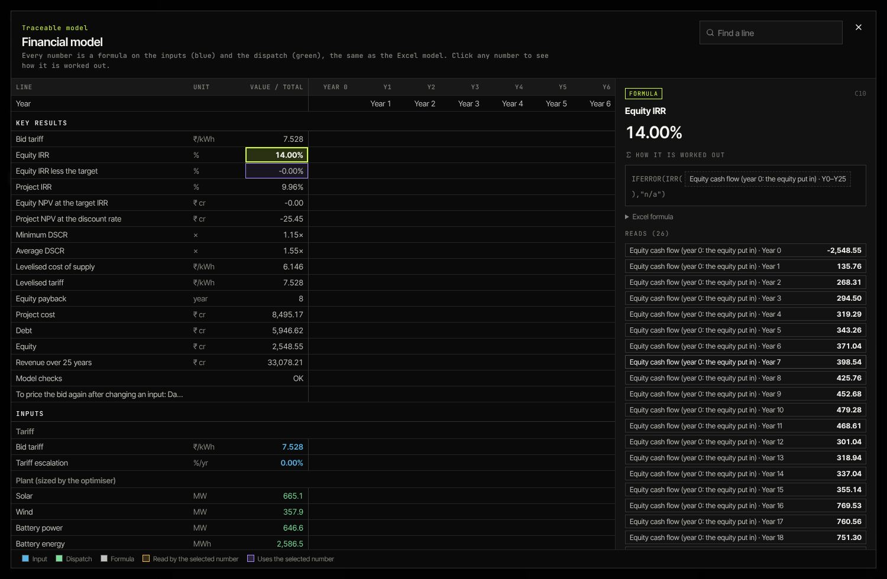

**The explorer (Trace the model).** The grid of the whole model as a spreadsheet: blue cells are
inputs (with where they came from), green cells the optimiser's energy, the rest formulas. Click a
cell: its formula with each reference as a chip, its precedents and dependents, and **the inputs it
rests on**. The search box finds a line; a year's energy opens the hour-by-hour dispatch behind it,
down to months and 15-minute blocks. Escape closes it.

---

## More inputs (finance team)

The finance team's groups (4.3a on Finance inputs, and under F.1 of the Financial model). Every
group starts closed and off: with nothing filled, the model gives exactly the numbers it gave
before. Open a group, read its one-line note, fill what your case needs. Everything is saved with
the bid and goes into the Excel workbook as inputs on their own sheet.

**Timeline.** *Commercial operation date*: the model's year 1 starts here (the tender's SCSD is
offered; **Use <date>** puts it back). Columns, the CSV and the workbook then carry real months
instead of Y1, Y2.

**Construction and commissioning.** *Phasing*: give each component (solar, wind, battery,
evacuation, other) the month it starts and how many months it spends; a component without a row
spends over the whole window. *Parts*: commission the plant in parts, each with its share and its
months after (or before, negative) the COD; the shares must add to 100 %. Year 1's energy, revenue
and O&M scale with the share of the year the parts run. *Bridge loan*: the first months drawn on a
bridge at its own rate, taken out by the term loan with a fee that goes into the project cost with
the IDC. Example: parts 50 % at 0 months and 50 % at 6 months give year 1 an operating share of
75 %.

**Generation and revenue.** *Generation case*: P50 (as modelled), P75 or P90, with the factors
(0.97 and 0.94 by default) the energy is scaled by; the DFR and the penalties follow. *Carbon credit
revenue*: tonnes per MWh × price, escalating, for the years credited; a revenue line, taxable.
Example: 0.71 t/MWh × ₹500/t on 2,000 MU a year is ₹71 cr. *Life extension*: extra years after
the PPA at a sale price (the surplus price until set), with the extension capex spent in the last
PPA year, an O&M factor and the degradation after the PPA; the table grows to PPA + extension
years. *Repowering*: solar repowering capex in a year and the energy uplift from the year after.
*Augmentation* (battery): every year to nameplate, a one-time restore, or **on a schedule** in the
years you list (6, 12, 18), each replacing what was lost since the last.

**Operating cost.** *O&M escalation* for solar, wind and battery separately (the common rate until
set). *Wind O&M by component*: rows with a label, ₹ lakh/MW and their own escalation (gearbox,
blades, balance of plant …). *Other fixed costs*: solar park fees, audit fees, asset management
fee, each as its own P&L line with its own escalation; their sum is the Other fixed line.

**Debt.** *Repayment after refinancing*: keep the method or re-sculpt to the target DSCR from the
refinancing year. *Rate step-down*: a lower rate from a year after COD. *Top-up*: new debt at the
end of a year (usually year 2) to a higher debt share; the new money is paid out to equity and
repaid over the years left. *Prepayment penalty*: on principal prepaid by a refinancing take-out or
the sweep. *Cash sweep*: a share of the free cash prepays principal between two years; what cannot
be paid accrues and is paid later. *Debt service reserve basis*: next year's service or the peak of
the years ahead, with the swing put aside or released each year; *interest on the reserve* is
other income.

**Quasi-equity and mezzanine.** *Quasi-equity* (promoter loans): part of the funding below the
senior debt, so the equity cheque falls by the amount; its interest is paid only in years whose
senior DSCR is above the lender's minimum, else it accrues; principal is repaid from the cash left
from the year you set. *Mezzanine*: a tranche with its rate, tenor, moratorium, equal or bullet
repayment and arrangement fee, paid every year; the Total DSCR counts its service.

**Guarantees.** Add the EMD, PBG, connectivity BG, statutory BG or a surety bond from the presets,
then type the amount (the tender's per-MW figures are in Money at stake). Each carries its fee,
the margin money blocked while it runs and the interest that money earns, from a year (0 = during
construction, where the fee is capitalised) for a number of years. Fees sit below EBITDA with the
working-capital interest; margin interest is other income.

**Tax and depreciation.** *Book depreciation*: straight line (as before) or written-down value;
both are worked out and shown in F.6. *Component lives* for solar, wind, battery, evacuation and
other. *Thin capitalisation*: interest on quasi-equity and mezzanine above this share of EBITDA is
disallowed and carried eight years (0 = off). *Loss carry-forward*: business losses lapse after
these years; unabsorbed depreciation never does. Quasi-equity interest is deductible when paid, not
when accrued.

**Returns.** *HoldCo expenses* a year and the *promoter's share* of the HoldCo give the HoldCo and
Promoter IRR in F.5 (the HoldCo funds the equity and the quasi-equity and receives dividends,
quasi interest and repayments). *Lender's reinvestment rate* for the MIRR.

**Sensitivity for the reverse auction.** The share of the hard cost in foreign currency, the
exchange rate it was priced at, and the module share of the solar capex: F.8 moves them.

*Not decided yet.* "Keep metrics proprietary": which outputs may leave the application (workbook,
CSV) and which stay on screen is an open point for the finance team; today nothing is withheld.

---

## Step 08 · What-if *(Finance)*

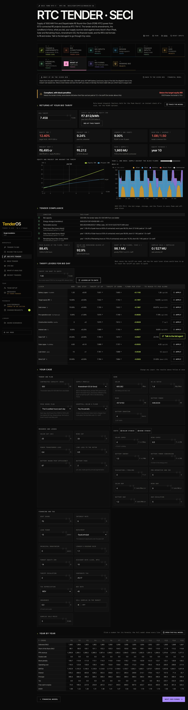

**Purpose.** Bid-day work on the sized plant: an instant, rule-based what-if (not the HiGHS
optimum) seeded from the bid, and the levers that move the tariff. **Back to the sized bid**
restores the seed; **Financial model** returns to step 07.

**1 · Returns at your bid tariff.** Type the **Bid tariff**: equity, project and lender's IRR, DSCR
against the lender's minimum, project cost, LCOE, year-1 supply, payback. *Tariff for a 14 %
equity IRR* shows what the target needs; **Bid at this tariff** sets it. Charts: the IRR curve
against the tariff, and a week of supply against the block floors (slide the week).

**2 · Tender compliance.** The bid range, storage, renewable sources and each floor's share of
hours met in year 1 and the worst year, with the energy short and its penalty; the verdict banner
at the top says compliant / with penalties / not compliant.

**3 · Tariff levers for bid day.** Enter the **Tariff you want to quote** and click **Compute the
levers** (about a second). Each row is one input moved one step up and one step down, everything
else as in the case: the tariff if up, if down, **₹/kWh per step**, and **how far that lever alone
would have to move** to reach your tariff; **Apply** moves the case's input there. Recompute after
changing the case (the button says when the levers are stale).

**4 · Your case.** Every input of the what-if in groups — tender and plan, size, resource and
losses, costs (with the **Solar studio** and **Wind studio** buttons), financing and tax — the
results above follow each change at once. **Year by year** at the foot: click a number for its
formula; **Open the full model** opens the explorer.

---

## Step 09 · Bid forms *(Tender / Legal)*

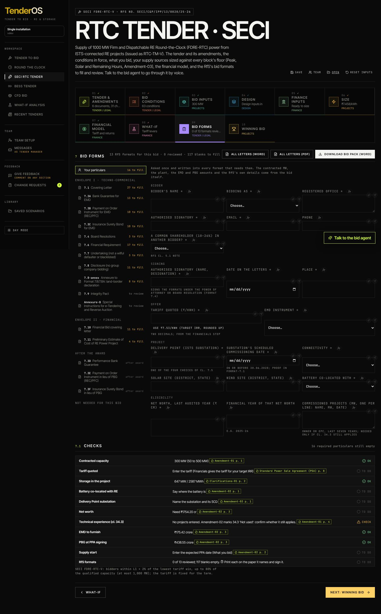

**Purpose.** The RfS formats, filled from the bid and reviewed one by one.

**7 · Bid forms.** The left column lists **Your particulars** (asked once: company, address,
signatory, bank, dates — written into every format that needs them) and the thirteen formats of
this bid with how many blanks each still has (*27 to fill*, *to review*, *after award*, *not
needed* for a single company). Click a format to open it on the right: the filled letter in the
RfS's own wording beside the RfS page it comes from; blanks are boxes; **Reviewed** ticks it once
read. **Use ₹x/kWh (target IRR, rounded up)** puts the model's tariff in the financial bid.

* **Assign** on a format hands it to a team (Finance for the bank guarantee, Legal for the
  undertakings); a signed copy uploaded by them is linked on the format once accepted.
* **All letters (Word)** / **All letters (PDF)** download every letter; **Download bid pack
  (Word)** builds the whole pack in one document.

**7.1 · Checks.** What still blocks the pack (particulars empty, formats not reviewed, the quote
below the target IRR) and the tender's award rule (L1 + 2 %).

---

## Step 10 · Winning bid *(Projects)*

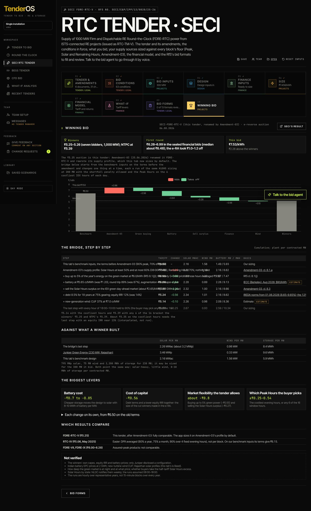

**Purpose.** How the auction's winners reached ₹5.25/kWh, and what it says about our bid.

**8 · Winning bid.** SECI's result with the link; the note explains which tender it is and how
the bridge was built (one HiGHS sizing per step at 200 MW).

**The bridge, step by step.** From this tab's benchmark inputs to the winners' tariff, one change
at a time (profile, battery cost, CUFs, IRR …), cumulative, with the plant per contracted MW at
each step. **Against what a winner built** compares solar, wind and storage per MW. **The biggest
levers** ranks what moved the tariff most. **Which results compare** says which auction results
are comparable with this tender.

---

## Working as a team

**Team setup** (sidebar). The super admin adds people with their name, team (Projects, Design,
Finance, Legal, Management, IT), title, the tabs they cover and email; everyone sees the table.
*Who to ping for what* lists, by tab, the people who cover it.

**Pings.** Hover any box, click its **send icon**, type `@` and a name (people who cover the tab
come first), write the question, Send. The person sees it under **Messages** (unread badge),
**Open field** takes them to the box, and they answer with a value; **Fill in** on your side puts
the value in the box. Threads stay with the box.

**Hand-offs (Team panel).** On a saved bid, **Assign** beside a box, a format or a condition asks
a team for it; their answer (a value, a note, an uploaded file such as a signed letter) comes back
to the Team panel; **Accept** writes it into the bid as a new version, **Return** sends it back
with a note. The **Outbox** shows the emails sent (the demo keeps them in-app).

**Evidence and sign-off.** Hover a box, click the **paperclip**: attach a note, a link or a file
(PDF, PNG, JPEG, Word, Excel), with the value at the time; the super admin **Sign off this value**
(green tick; amber once the value changes, with the signed value shown). **Register (CSV)**
downloads the tab's evidence register.

**Save and versions.** **Save** names the bid; every save and every accepted answer is a version.
**Open** (library) lists saved bids by module with their versions; open one to continue, compare
or restore a version.

---

## Giving feedback on the application

**Give feedback** (sidebar) switches feedback on: a banner says so, the section under the mouse is
outlined (dotted) and the element under it (a button, a box, a cell, a tile, a step chip) solid.
Click it: a note opens headed by that element, with its value now, the section, the step and the
tab; write what should change, choose the **department that needs this change**, Send. It is
recorded as a change request (*CR-n*). **Done** or Escape switches feedback off.

**Change requests** (sidebar) lists every request with when, where, the comment, who raised it,
the department it is for, and its status. The super admin **Approve**s or **Reject**s; **Export
approved as a prompt (.md)** downloads one file for jouleWise, who apply it and ship the change;
**Mark done** closes it.

---

## Setting up the API keys (administrator)

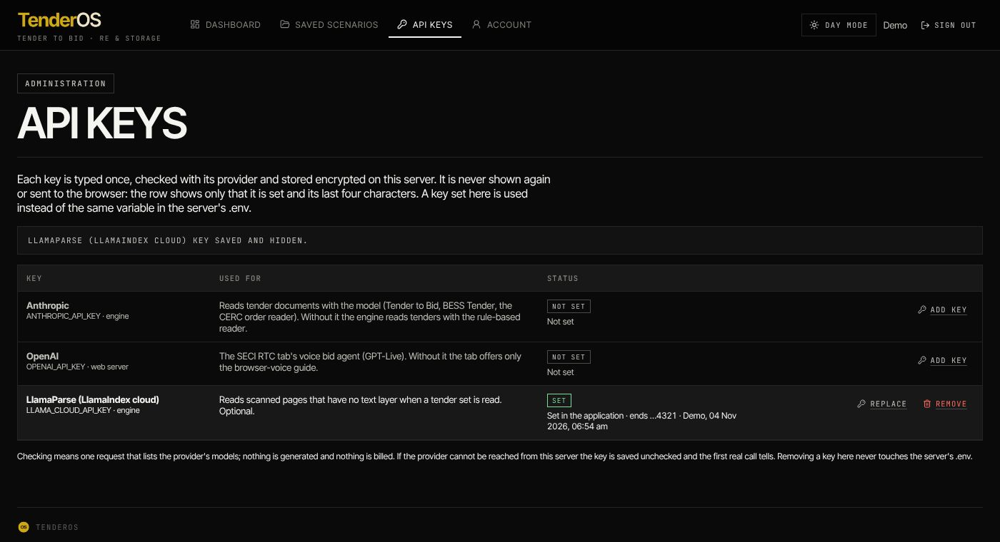

**API keys** (sidebar, under Library; shown to administrators and to the tender's super admin)
holds the three provider keys the product can use: **Anthropic** (reading tender documents with
the model), **OpenAI** (the voice bid agent on the SECI tab) and **LlamaParse** (scanned pages in
a tender set). For each: click **Add key**, paste the key (it is typed hidden; the eye shows it
while you type), click **Check and save**. The key is checked with the provider (one request that
lists its models, nothing billed), stored encrypted on the server and never shown again: the row
says *Set*, *ends …abcd*, who set it and when. **Replace** types a new one; **Remove** deletes it
(a key in the server's `.env`, if any, then applies again). A refused key is not saved; a key
whose provider cannot be reached is saved with a warning. No restart is needed: the voice agent
and the tender reader use the new key on their next call.

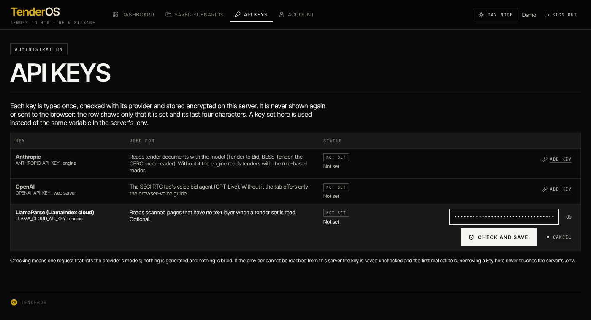

## Quick reference: a bid in twelve clicks

1. **SECI RTC tender** in the sidebar.
2. **03 Bid inputs** → Contracted capacity, profile, Peak Hours plan, shortfall rule, PPA date.
3. **04 Design** → **Fill up for me please**, then replace the benchmarks with your numbers,
   upload your profiles, set the losses and the sites.
4. **Continue to Finance inputs** → terms, repayment, construction, working capital, DSM →
   **Size the plant**.
5. Wait for the sizing; read **4.2 Tender conditions**.
6. **07 Financial model** → the bid tariff; **Download financial model (Excel)**.
7. **5.0 Your quote** → type the tariff you will quote.
8. **08 What-if** → **Compute the levers**.
9. **09 Bid forms** → particulars, review each format, **Download bid pack (Word)**.
10. **Save** the bid; **Assign** what others must supply; attach **evidence** to the inputs.
11. **Run the 15-minute dispatch** on Size for the compliance workbook.
12. **10 Winning bid** for the comparison with the auction.

---

## Frequently asked

**The chip says "17 inputs needed" — which?** The bar at the foot of Design (and of Finance
inputs) lists them; **Fill up for me please** fills every empty one with a marked benchmark.

**Why is the bid tariff higher than the HiGHS tariff?** The sizing screens designs on a fast
25-year model; the financial model then prices the chosen plant in full (tax with losses carried,
working capital, DSM, reserves). The two are shown side by side on the Bid tariff tile.

**I changed an input after sizing.** Design and Finance inputs that affect the plant clear the
sizing (the chip goes back to *Not sized*): size again. Financial-only inputs recompute the model
at once.

**Can I fix the tariff and see the returns?** Yes: on the Financial model, lock the **Tariff** box
(F.1) and type it; or type a quote in **5.0 Your quote**; or use the What-if's **Bid tariff**.

**Where do the benchmarks come from?** CERC norms and 2025–26 market prices; the hint under each
filled box says so until you replace it. The tender sets none of them.

**The Excel does not recalculate.** Enable editing / calculation in Excel; every sheet is
formulas on the Live model's blue cells. The workbook is verified against the application in
TenderOS's own tests.
